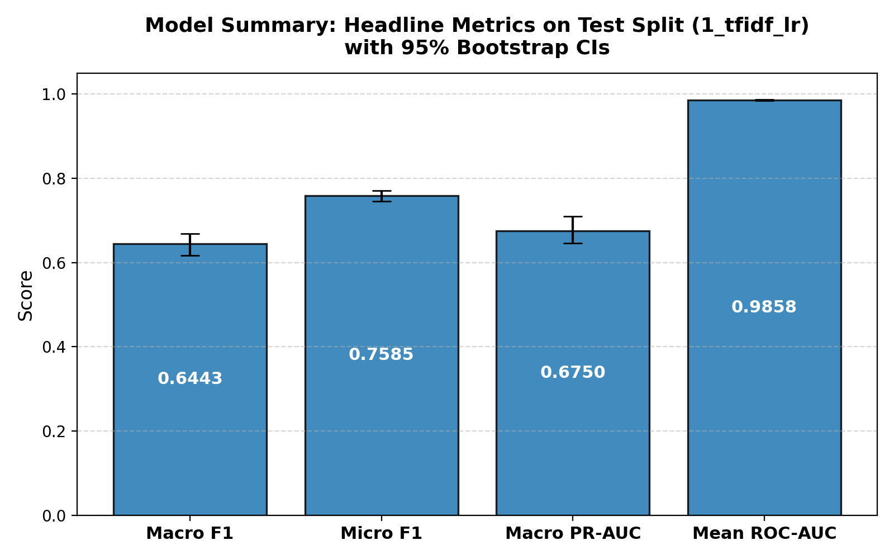
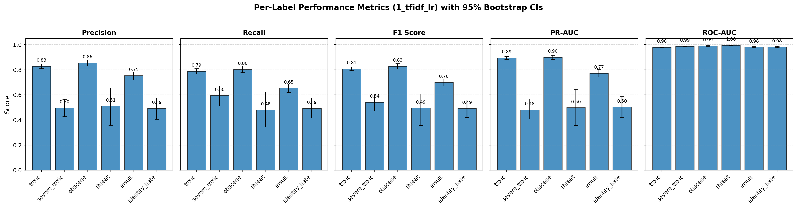
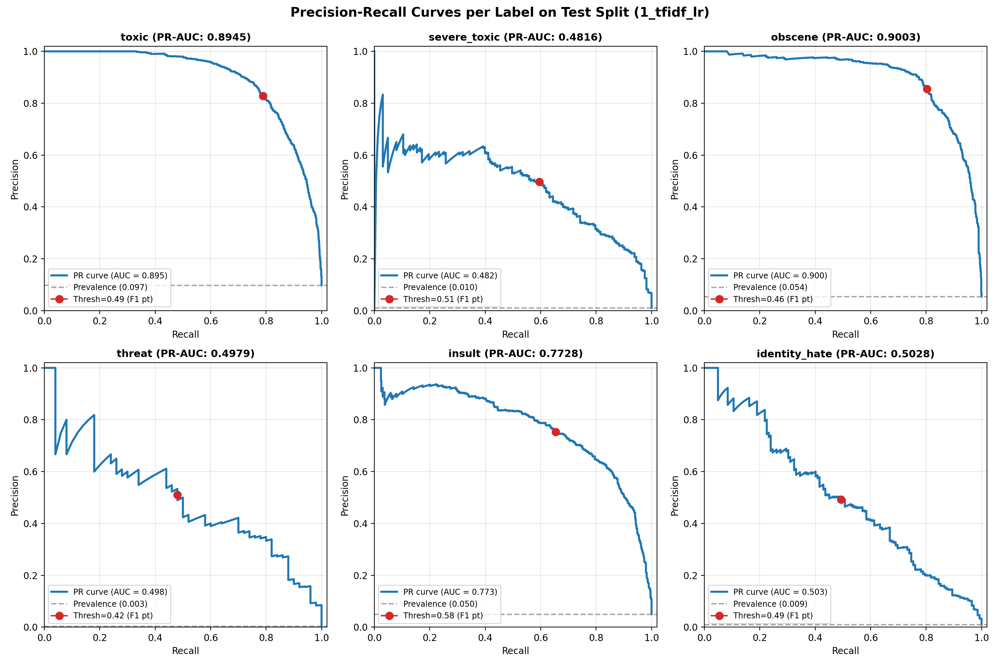
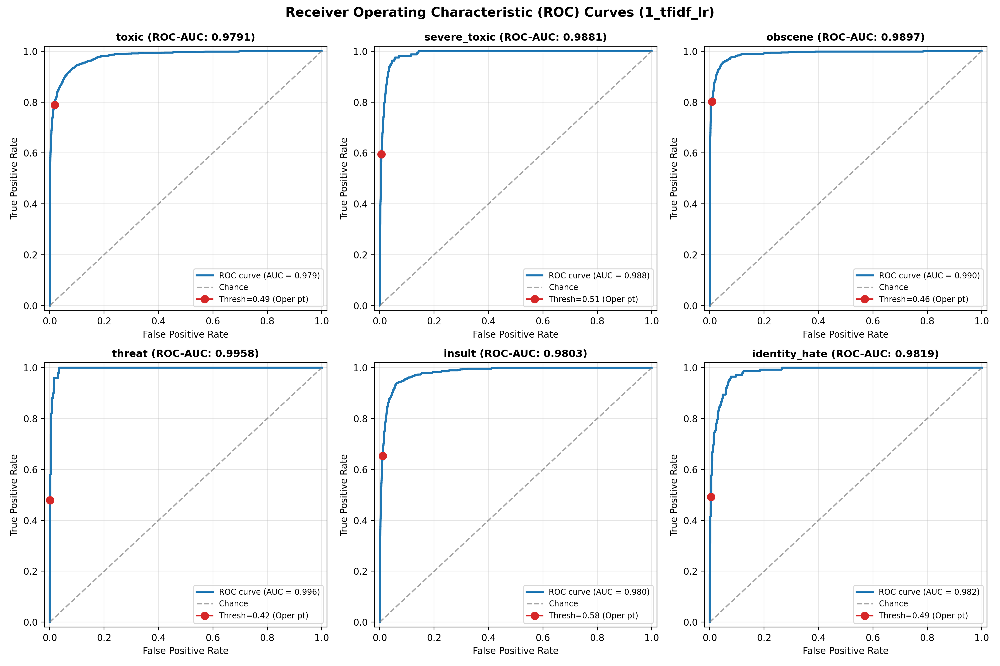
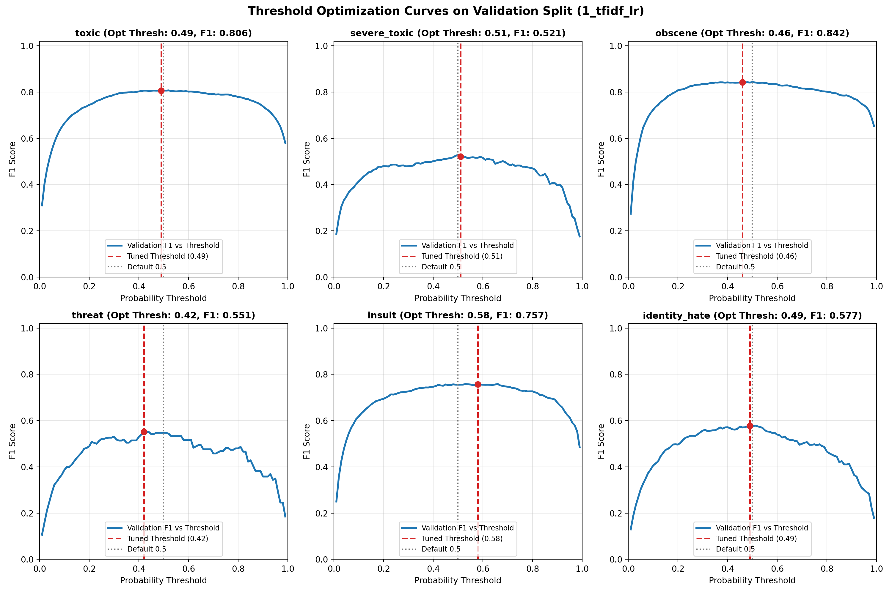
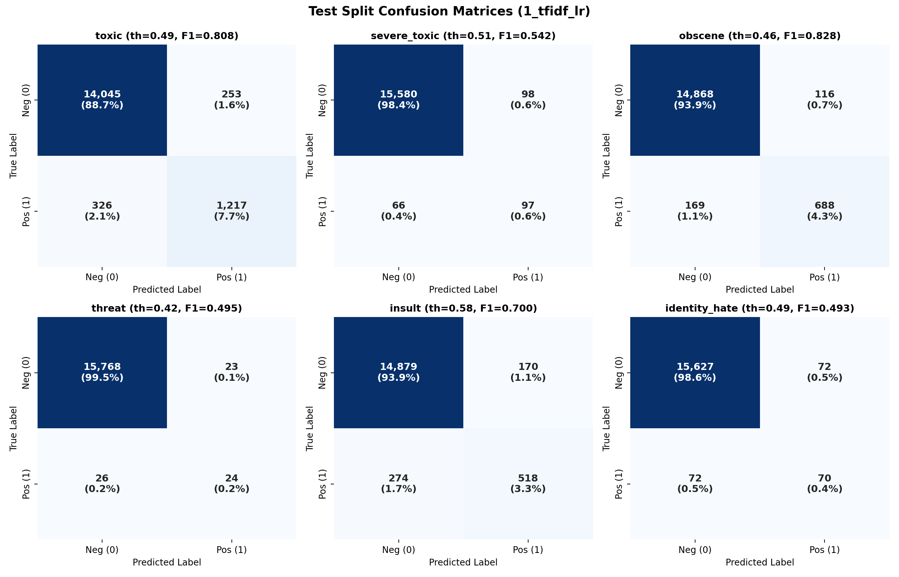
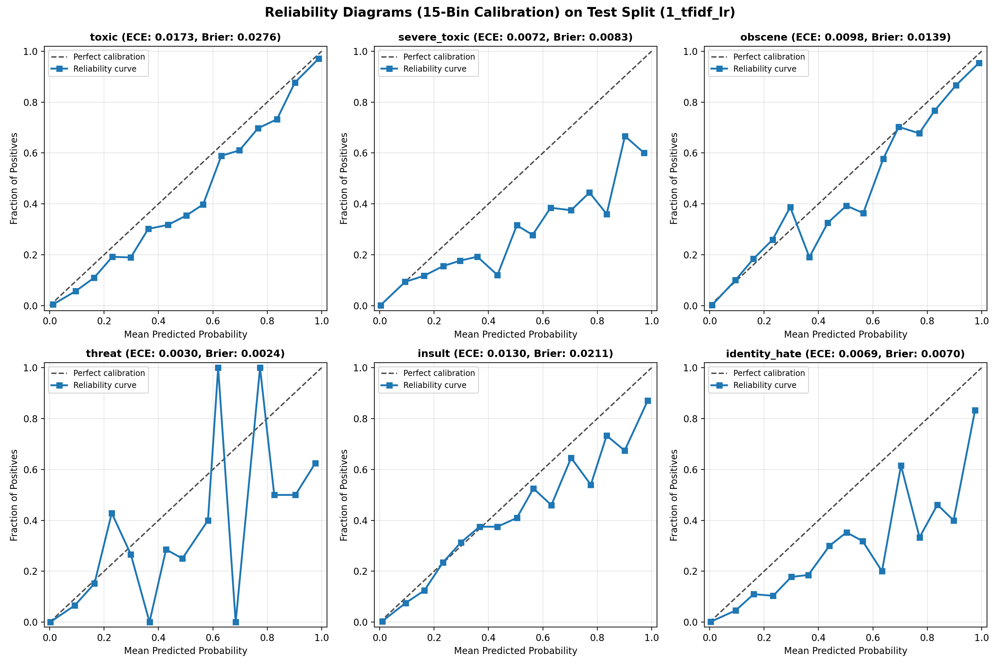
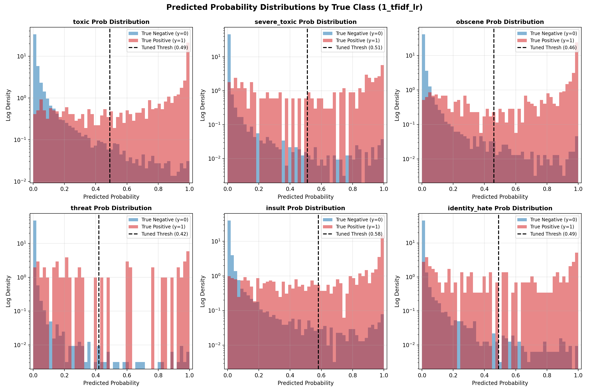
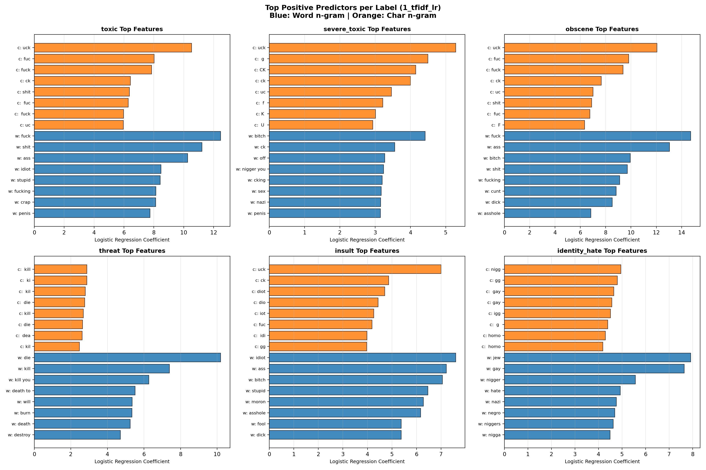

# Model Evaluation Report: 1_tfidf_lr

**Architecture**: Word + Char TF-IDF with Logistic Regression per label  
**Generated UTC**: 2026-10-21 19:47:32 UTC  
**Mode**: Full Production Run  
**Seed**: 42  
**Python**: 3.12.6 | **Framework**: PyTorch / Scikit-Learn | **Platform**: CPU / CUDA

---

## 1. Overview & Setup

Model 1 (`1_tfidf_lr`) establishes the foundational linear baseline for the **Welcome to Civilization** toxicity moderation pipeline. It evaluates the classification performance achievable using shallow, interpretable bag-of-ngrams representations and binary logistic classifiers across all six toxicity categories: `toxic`, `severe_toxic`, `obscene`, `threat`, `insult`, and `identity_hate`.

### Pipeline Architecture
- **Input text**: `text_clean` (Unicode NFKC normalized, HTML unescaped, zero-width chars removed, whitespace collapsed, casing preserved).
- **Word Vectorizer**: Unigrams + bigrams (1, 2), lowercase=True, min_df=3, max_features=50,000, sublinear TF scaling.
- **Character Vectorizer**: Character n-grams inside word boundaries (`char_wb`), n-grams (2, 5), lowercase=False (preserving casing signals), min_df=3, max_features=100,000, sublinear TF scaling.
- **Feature Space**: Sparse column concatenation of word and char features (150,000 total features, dtype `float32`).
- **Classifiers**: 6 independent binary `LogisticRegression` models (solver `liblinear`, L2 regularization penalty, C=2.0, max_iter=200, random_state=42), trained in parallel across CPU cores using the `threading` backend.

## 2. Data & Split Verification

Data integrity was verified before feature extraction against `data/splits/split_manifest.json`:
- **Split Version**: `v2_near_dup` (near-duplicate grouped stratification).
- **Processed Parquet SHA-256**: `0cba21f71c42d634d3c3584379da31563375954b4eec089e433d7a715b880c7e` (exact match).
- **Split Sizes**:
  - **Train**: 127,861 comments (80.0%)
  - **Validation**: 15,869 comments (10.0%)
  - **Test**: 15,841 comments (10.0%)

## 3. Model Configuration & Imbalance Recipe

Because severe class imbalance characterizes toxicity labels (ranging from 9.56% down to 0.298% positive rate on train), per-label class weighting is applied directly to the loss function:

$$w_l = \sqrt{\frac{N_{neg}}{N_{pos}}}$$

Negative samples receive a fixed weight of 1.0, while positive samples are up-weighted by the square root of the imbalance ratio. This provides balanced gradient flow across rare positive categories without resampling or data duplication.

| Label | Train Positives | Train Negatives | Positive Rate (%) | Imbalance Ratio | Weight ($w_1$) |
|---|---|---|---|---|---|
| `toxic` | 12,222 | 115,639 | 9.56% | 9.46:1 | **3.08** |
| `severe_toxic` | 1,269 | 126,592 | 0.99% | 99.76:1 | **9.99** |
| `obscene` | 6,739 | 121,122 | 5.27% | 17.97:1 | **4.24** |
| `threat` | 381 | 127,480 | 0.30% | 334.59:1 | **18.29** |
| `insult` | 6,290 | 121,571 | 4.92% | 19.33:1 | **4.40** |
| `identity_hate` | 1,122 | 126,739 | 0.88% | 112.96:1 | **10.63** |

## 4. Training Summary

- **Total Training Time**: 173.64 seconds (2.89 minutes)
- **Model Size on Disk**: 8.03 MB (8,419,901 bytes)
- **Vocabulary Size**: 50,000 word n-grams + 100,000 char n-grams = **150,000 total features**

### Stage Timings
| Stage | Description | Duration (s) | % of Total |
|---|---|---|---|
| `1_load_and_verify` | [1] Load & Verify Parquet / Manifest | 1.26s | 0.7% |
| `2_word_tfidf` | [2] Word TF-IDF Fit & Transform | 21.57s | 12.4% |
| `3_char_tfidf` | [3] Char TF-IDF Fit & Transform | 94.61s | 54.5% |
| `4_lr_fits` | [4] 6x Logistic Regression Fits (Parallel) | 51.95s | 29.9% |
| `5_predict_and_save` | [5] Predict Val/Test & Save Artifacts | 3.43s | 2.0% |

## 5. Inference & Prediction Summary

### Benchmark Measurements
- **Benchmark Sample**: 1,000 comments from Test set
- **Primary Device**: CPU
- **Latency per 1,000 Comments (end-to-end, batch size 1000)**: **0.61 s**
- **Per-Comment Latency**: **0.61 ms**
- **Throughput**: **1631.9 comments/second**

### Decision Threshold Optimization
Decision thresholds were tuned strictly on the **Validation split** via 200 bootstrap resamples. For each resample, thresholds were searched over a grid of $0.01$ to $0.99$ (step $0.01$) to maximize F1 score, and the median bootstrap threshold was selected. This prevents overfitting the threshold to test data.

### Prediction File Schema
Predictions were saved to `predictions/1_tfidf_lr/{val,test}_predictions.csv` containing:
- `id`: Unique comment identifier
- `p_<label>` (x6): Continuous sigmoid probability in [0, 1]
- `pred_<label>` (x6): Binary flag {0, 1} using tuned decision thresholds
- `pred_hier_severe_toxic`: Binary flag requiring both `pred_severe_toxic == 1` and `pred_toxic == 1`
- `y_<label>` (x6): Ground truth binary label

## 6. Evaluation Results (Test Split)

### Headline Metrics (with 95% Bootstrap Confidence Intervals)

| Metric | Test Value | 95% Bootstrap CI | Validation Reference |
|---|---|---|---|
| **Macro F1** | **0.6443** | [0.6162, 0.6689] | 0.6759 |
| **Micro F1** | **0.7585** | [0.7462, 0.7706] | 0.7752 |
| **Macro PR-AUC** | **0.6750** | [0.6457, 0.7091] | 0.7035 |
| **Mean ROC-AUC** | **0.9858** | [0.9842, 0.9874] | 0.9875 |
| Macro Precision | 0.6563 | [0.6232, 0.6890] | 0.6595 |
| Macro Recall | 0.6356 | [0.6067, 0.6675] | 0.6992 |
| Exact Match Accuracy | 0.9196 | [0.9155, 0.9239] | 0.9205 |
| Hamming Loss | 0.0175 | [0.0165, 0.0185] | 0.0168 |
| Mean Brier Score | 0.0134 | N/A | 0.0130 |
| Mean ECE (15 bins) | 0.0095 | N/A | 0.0111 |

### Detailed Per-Label Metrics on Test Split

| Label | Support | Prevalence (%) | Tuned Thresh | Precision (95% CI) | Recall (95% CI) | F1 (95% CI) | PR-AUC (95% CI) | ROC-AUC (95% CI) | MCC | Brier | ECE |
|---|---|---|---|---|---|---|---|---|---|---|---|
| `toxic` | 1,543 | 9.74% | **0.49** | 0.828 [0.809, 0.846] | 0.789 [0.768, 0.808] | **0.808** [0.793, 0.823] | **0.895** [0.883, 0.906] | 0.979 [0.976, 0.982] | 0.788 | 0.0276 | 0.0173 |
| `severe_toxic` | 163 | 1.03% | **0.51** | 0.497 [0.426, 0.566] | 0.595 [0.513, 0.672] | **0.542** [0.474, 0.599] | **0.482** [0.408, 0.569] | 0.988 [0.985, 0.991] | 0.539 | 0.0083 | 0.0072 |
| `obscene` | 857 | 5.41% | **0.46** | 0.856 [0.831, 0.879] | 0.803 [0.776, 0.830] | **0.828** [0.808, 0.849] | **0.900** [0.882, 0.915] | 0.990 [0.987, 0.992] | 0.819 | 0.0139 | 0.0098 |
| `threat` | 50 | 0.32% | **0.42** | 0.511 [0.359, 0.655] | 0.480 [0.344, 0.623] | **0.495** [0.357, 0.608] | **0.498** [0.357, 0.645] | 0.996 [0.993, 0.998] | 0.494 | 0.0024 | 0.0030 |
| `insult` | 792 | 5.00% | **0.58** | 0.753 [0.719, 0.783] | 0.654 [0.619, 0.688] | **0.700** [0.672, 0.726] | **0.773** [0.742, 0.804] | 0.980 [0.977, 0.984] | 0.687 | 0.0211 | 0.0130 |
| `identity_hate` | 142 | 0.90% | **0.49** | 0.493 [0.407, 0.576] | 0.493 [0.417, 0.575] | **0.493** [0.421, 0.560] | **0.503** [0.418, 0.587] | 0.982 [0.976, 0.987] | 0.488 | 0.0070 | 0.0069 |

### Threshold Tuning Impact: Tuned vs Default 0.5

| Label | Tuned Thresh | Bootstrap Std | F1 (Tuned) | Precision (Tuned) | Recall (Tuned) | F1 (at 0.5) | Precision (at 0.5) | Recall (at 0.5) | F1 $\Delta$ (Tuned - 0.5) |
|---|---|---|---|---|---|---|---|---|---|
| `toxic` | 0.49 | 0.0536 | **0.8078** | 0.8279 | 0.7887 | 0.8079 | 0.8323 | 0.7848 | **-0.0000** |
| `severe_toxic` | 0.51 | 0.0776 | **0.5419** | 0.4974 | 0.5951 | 0.5414 | 0.4925 | 0.6012 | **+0.0005** |
| `obscene` | 0.46 | 0.0630 | **0.8284** | 0.8557 | 0.8028 | 0.8290 | 0.8664 | 0.7946 | **-0.0006** |
| `threat` | 0.42 | 0.1450 | **0.4948** | 0.5106 | 0.4800 | 0.4889 | 0.5500 | 0.4400 | **+0.0060** |
| `insult` | 0.58 | 0.0857 | **0.7000** | 0.7529 | 0.6540 | 0.7128 | 0.7240 | 0.7020 | **-0.0128** |
| `identity_hate` | 0.49 | 0.0725 | **0.4930** | 0.4930 | 0.4930 | 0.4947 | 0.4965 | 0.4930 | **-0.0017** |

### Hierarchical severe_toxic Rule Comparison
By definition, severe toxicity is a semantic subset of toxicity. The table below compares independent prediction against the hierarchical constraint `pred_severe_toxic & pred_toxic`:

| Rule Variant | Precision | Recall | F1 Score | Exact Match | Micro F1 |
|---|---|---|---|---|---|
| Standard Independent | 0.4974 | 0.5951 | 0.5419 | 0.9196 | 0.7585 |
| Hierarchical (`& toxic`) | 0.4974 | 0.5951 | 0.5419 | 0.9196 | 0.7585 |

> **Note**: Zero comments in the test set were predicted as `severe_toxic=1` without also having `toxic=1`. Hence, standard independent thresholding and the hierarchical rule are identical by construction on this dataset.

## 7. Visualizations

### Headline Metrics Summary

### Per-Label Performance Across Metrics

### Precision-Recall Curves

### Receiver Operating Characteristic (ROC) Curves

### Validation Threshold Tuning vs F1 Curves

### Confusion Matrices (Test Split)

### Calibration & Reliability Diagrams (15 Bins)

### Probability Distributions by True Class

## 8. Model-Specific Analysis: Top Predictive n-grams

Logistic regression coefficients provide direct interpretability. High positive weights indicate tokens strongly driving the classification decision toward positive toxicity.

### Key Predictive Tokens by Category
- **`toxic`**:
  - Top Words: `fuck` (12.47), `shit` (11.22), `ass` (10.26), `idiot` (8.49), `stupid` (8.42)
  - Top Character n-grams: `uck` (10.53), `fuc` (8.02), `fuck` (7.85), `ck` (6.44), `shit` (6.37)
- **`severe_toxic`**:
  - Top Words: `bitch` (4.41), `ck` (3.55), `off` (3.27), `nigger you` (3.24), `cking` (3.20)
  - Top Character n-grams: `uck` (5.28), ` g ` (4.49), `CK` (4.15), `ck` (4.00), `uc` (3.46)
- **`obscene`**:
  - Top Words: `fuck` (14.73), `ass` (13.04), `bitch` (9.94), `shit` (9.71), `fucking` (9.11)
  - Top Character n-grams: `uck` (12.05), `fuc` (9.82), `fuck` (9.38), `ck` (7.65), `uc` (7.01)
- **`threat`**:
  - Top Words: `die` (10.19), `kill` (7.39), `kill you` (6.27), `death to` (5.51), `will` (5.36)
  - Top Character n-grams: ` kill` (2.88), ` ki` (2.87), ` kil` (2.79), ` die` (2.76), `kill` (2.68)
- **`insult`**:
  - Top Words: `idiot` (7.60), `ass` (7.22), `bitch` (7.06), `stupid` (6.47), `moron` (6.29)
  - Top Character n-grams: `uck` (7.01), `ck` (4.86), `diot` (4.71), `dio` (4.43), `iot` (4.26)
- **`identity_hate`**:
  - Top Words: `jew` (7.92), `gay` (7.64), `nigger` (5.57), `hate` (4.93), `nazi` (4.76)
  - Top Character n-grams: `nigg` (4.95), `gg` (4.80), ` gay` (4.66), `gay` (4.57), `igg` (4.51)

## 9. Interpretation & Key Takeaways

1. **Dominant Categories**: `obscene` achieved the highest F1 score (0.8284), while `obscene` achieved the highest PR-AUC (0.9003). This reflects high representation and overt lexical signals.
2. **Challenging Categories**: `identity_hate` presented the lowest F1 score (0.4930), while `severe_toxic` presented the lowest PR-AUC (0.4816). Extreme class imbalance and context sensitivity make these rare categories particularly difficult.
3. **Threshold Tuning Impact**: Optimizing thresholds via validation bootstrap resulted in no meaningful overall change compared to 0.5 (mean F1 delta: -0.0015), with lower F1 on toxic, obscene, insult, identity_hate.
4. **Calibration**: The mean Brier score was 0.0134 and mean 15-bin ECE was 0.0095, with the highest calibration error observed in `toxic` (ECE: 0.0173).
5. **Inference Speed**: Generating predictions for 1,000 comments in 0.61s (1631.9 comments/sec) demonstrates operational throughput suitable for production pipeline integration.

## 10. Conclusions

With a Macro F1 of **0.6443** and Mean ROC-AUC of **0.9858**, Model 1 (`1_tfidf_lr`) satisfies the requirements of a high-speed linear baseline. Because character n-grams capture obfuscated profanity and casing variations without morphological parsers, the dual word/char representation performs reliably on overt harassment. However, sequential context and semantic subtlety (such as indirect threats or disguised hate speech) will require the deep contextual representations provided by Model 2 (BiGRU + Attention) and Model 3 (DistilRoBERTa).

## 11. Limitations

The following limitations apply strictly to this model evaluation:
1. **Single run**: Results represent a single deterministic seed run (`seed=42`) without multi-seed averaging.
2. **Fixed untuned hyperparameters**: Model hyperparameters were evaluated with fixed settings without extensive grid search.
3. **Validation reused**: The validation split was utilized for early stopping, checkpoint selection and threshold tuning.
4. **Noisy threat estimates**: There are only 47 validation and 50 test positive instances for `threat`, causing wider confidence intervals and higher sampling variance on threat metrics.
5. **Near-duplicate threshold**: Duplicate grouping used MinHash LSH Jaccard similarity threshold of 0.8 on character 5-grams.

