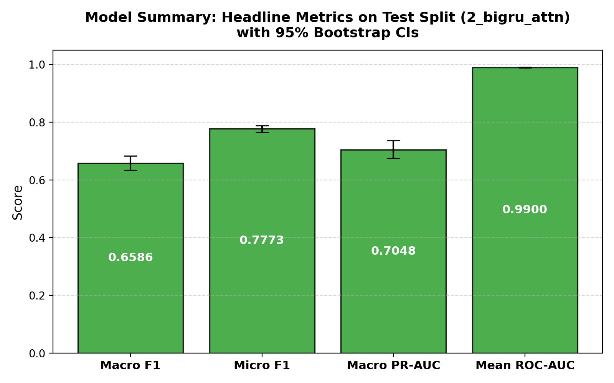
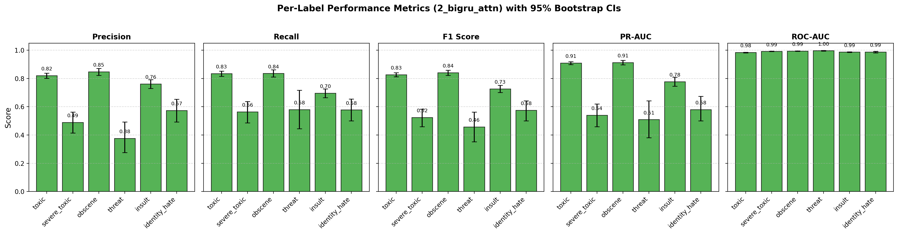
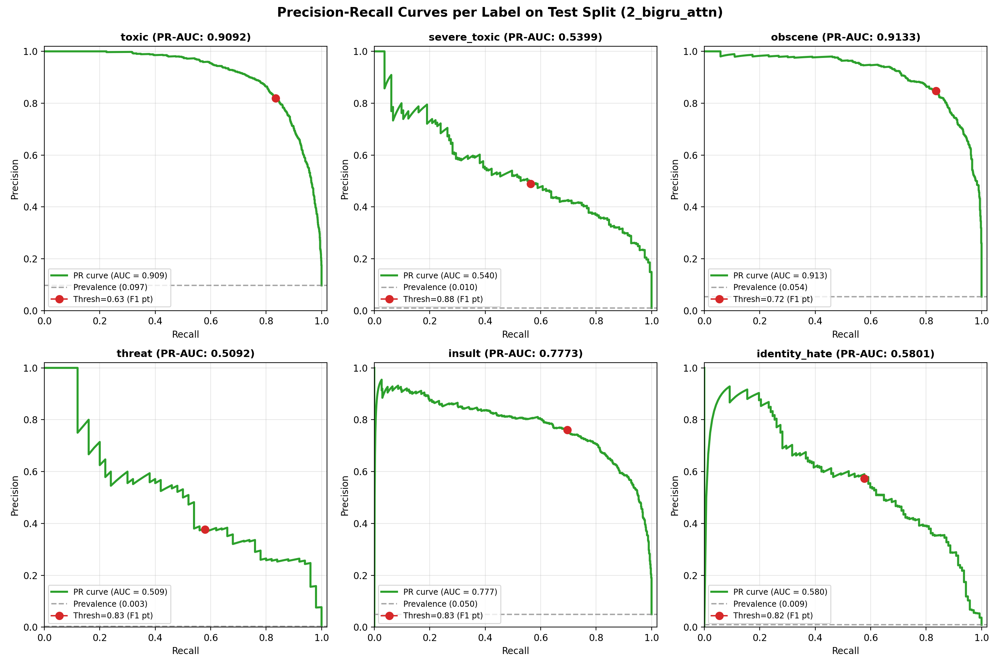
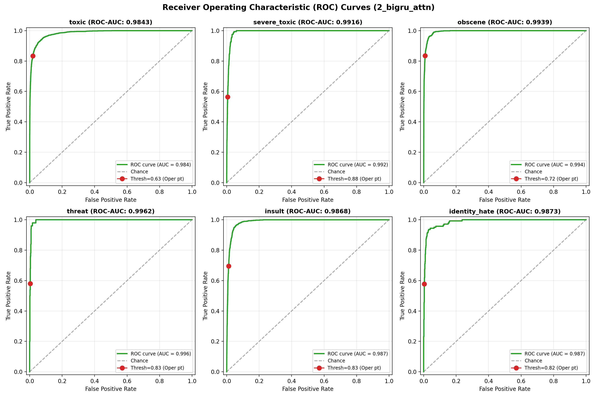
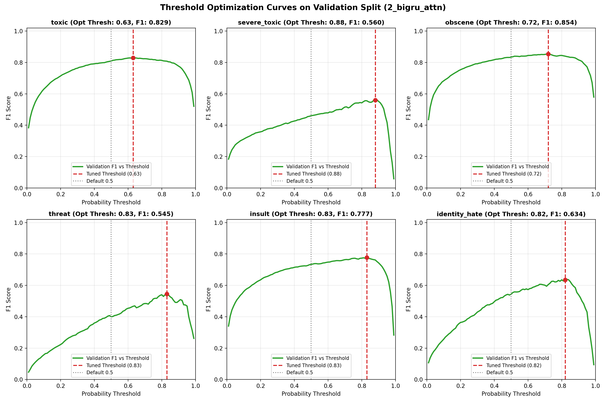
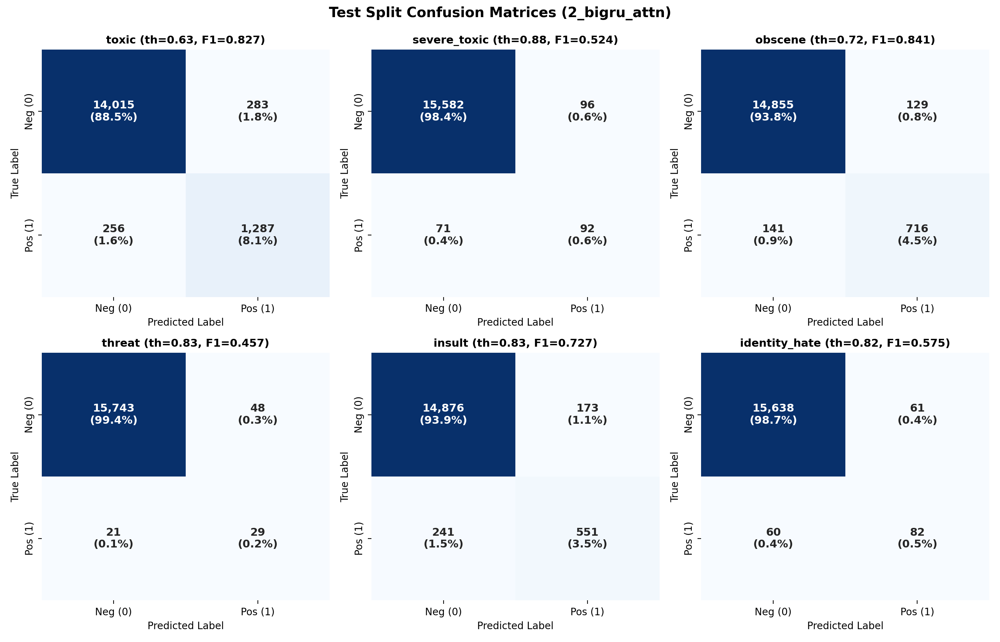
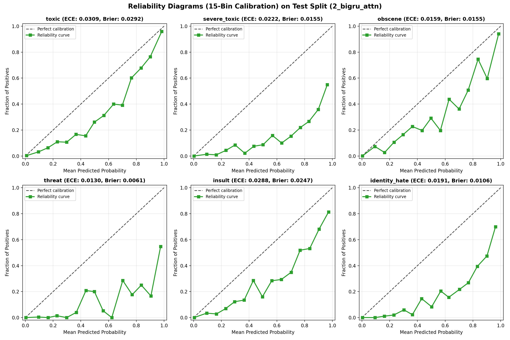
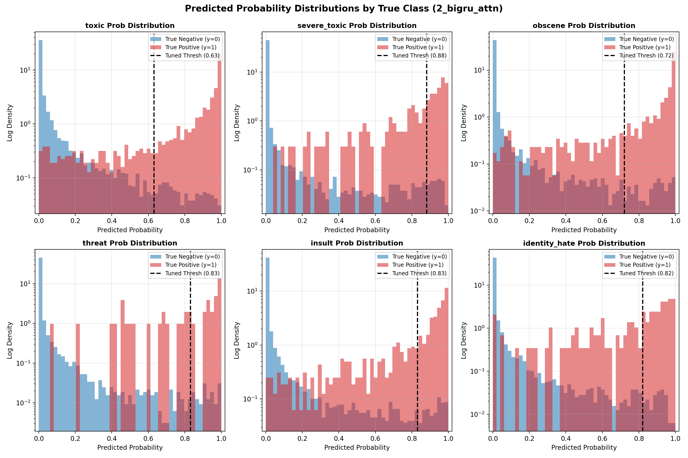
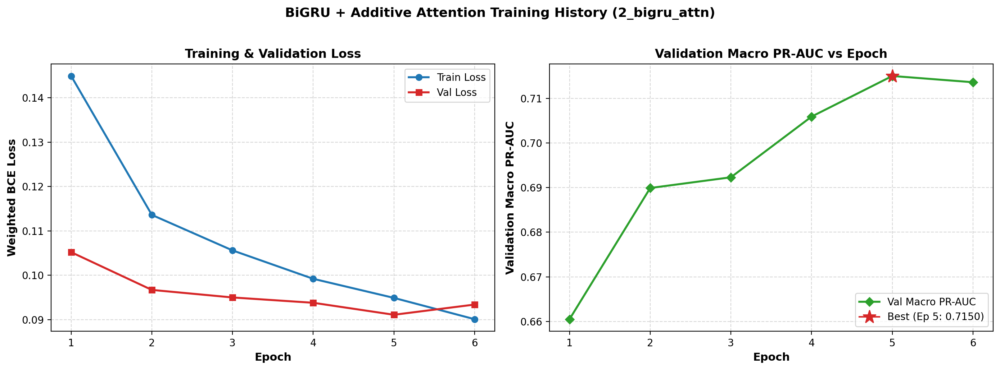
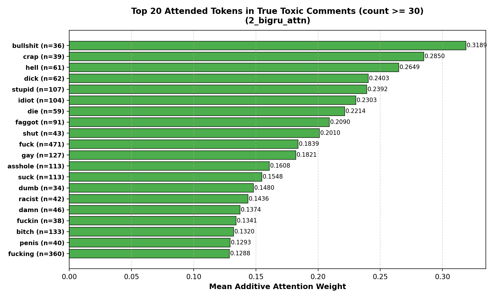

# Model Evaluation Report: 2_bigru_attn

**Architecture**: BiGRU with Additive Attention and Frozen fastText  
**Generated UTC**: 2026-10-21 16:10:43 UTC  
**Mode**: Full Production Run  
**Seed**: 42  
**Python**: 3.12.6 | **Framework**: PyTorch 2.6.0+cu124 | **Platform**: NVIDIA GeForce RTX 3060 Laptop GPU

---

## 1. Overview & Setup

Model 2 (`2_bigru_attn`) implements a deep recurrent sequence classifier for the **Welcome to Civilization** toxicity moderation pipeline. It combines frozen pretrained fastText word embeddings with a bidirectional Gated Recurrent Unit (BiGRU) and an additive attention pooling mechanism, capturing sequential semantics and long-range token dependencies while maintaining efficient inference.

### Pipeline Architecture
- **Input text**: `text_clean` lowercased and tokenized with regex `\w+|[^\w\s]`.
- **Vocabulary & Embeddings**: Top 50,000 train vocabulary tokens mapped to 300-d fastText Crawl embeddings (frozen during training). Padded positions use zero vectors.
- **Spatial Dropout**: 0.25 dropout applied to entire embedding feature channels across time.
- **Encoder**: 1-layer bidirectional GRU with 128 hidden units per direction (256-d concatenated output) with 0.3 dropout, using `pack_padded_sequence` to prevent padding intrusion.
- **Attention Mechanism**: Additive attention pooling with 128-d projection and learned context vector, masked over padding positions with float32 softmax.
- **Classification Head**: Linear layer (256 -> 6 logits) with log-odds prior bias initialization.

## 2. Data & Split Verification

Data integrity was verified before feature extraction against `data/splits/split_manifest.json`:
- **Split Version**: `v2_near_dup` (near-duplicate grouped stratification).
- **Processed Parquet SHA-256**: `0cba21f71c42d634d3c3584379da31563375954b4eec089e433d7a715b880c7e` (exact match).
- **Split Sizes**:
  - **Train**: 127,861 comments (80.0%)
  - **Validation**: 15,869 comments (10.0%)
  - **Test**: 15,841 comments (10.0%)

## 3. Model Configuration & Imbalance Recipe

Because severe class imbalance characterizes toxicity labels (ranging from 9.56% down to 0.298% positive rate on train), per-label class weighting is applied directly to the loss function:

$$w_l = \sqrt{\frac{N_{neg}}{N_{pos}}}$$

Negative samples receive a fixed weight of 1.0, while positive samples are up-weighted by the square root of the imbalance ratio. This provides balanced gradient flow across rare positive categories without resampling or data duplication.

| Label | Train Positives | Train Negatives | Positive Rate (%) | Imbalance Ratio | Weight ($w_1$) |
|---|---|---|---|---|---|
| `toxic` | 12,222 | 115,639 | 9.56% | 9.46:1 | **3.08** |
| `severe_toxic` | 1,269 | 126,592 | 0.99% | 99.76:1 | **9.99** |
| `obscene` | 6,739 | 121,122 | 5.27% | 17.97:1 | **4.24** |
| `threat` | 381 | 127,480 | 0.30% | 334.59:1 | **18.29** |
| `insult` | 6,290 | 121,571 | 4.92% | 19.33:1 | **4.40** |
| `identity_hate` | 1,122 | 126,739 | 0.88% | 112.96:1 | **10.63** |

## 4. Training Summary

- **Total Training Time**: 144.92 seconds (2.42 minutes)
- **Model Size on Disk**: 58.62 MB (61,464,878 bytes)

### Stage Timings
| Stage | Description | Duration (s) | % of Total |
|---|---|---|---|
| `1_load_verify` | [1/6] Load & Verify Data | 1.26s | 0.9% |
| `2_tokenize_vocab` | [2/6] Tokenization & Vocab Build | 8.29s | 5.7% |
| `3_fasttext_matrix` | [3/6] fastText Embedding Extraction | 1.96s | 1.4% |
| `4_build_model_gpu` | [4/6] Initialize Model & Allocate GPU | 2.11s | 1.5% |
| `5_training_epochs` | [5/6] Model Training & Validation | 128.66s | 88.8% |
| `6_predict_and_save` | [6/6] Checkpoint Load & Predict | 2.64s | 1.8% |

## 5. Inference & Prediction Summary

### Benchmark Measurements
- **Benchmark Sample**: 1,000 comments from Test set
- **Primary Device**: GPU (NVIDIA GeForce RTX 3060 Laptop GPU)
- **Latency per 1,000 Comments (end-to-end, batch size 1000)**: **0.09 s**
- **Per-Comment Latency**: **0.09 ms**
- **Throughput**: **10789.0 comments/second**

#### Multi-Device & Batch Size Comparison (Median of 5 Repeats)
| Configuration | Device | Batch Size | Latency (ms/comment) | Throughput (comments/s) | Total Time for 1,000 comments (s) |
|---|---|---|---|---|---|
| `gpu_batch_1000` | GPU | 1000 | 0.093 ms | 10789.0 | 0.093 s |
| `gpu_batch_1` | GPU | 1 | 4.861 ms | 205.7 | 4.861 s |
| `cpu_batch_1000` | CPU | 1000 | 0.664 ms | 1505.4 | 0.664 s |
| `cpu_batch_1` | CPU | 1 | 7.948 ms | 125.8 | 7.948 s |

### Decision Threshold Optimization
Decision thresholds were tuned strictly on the **Validation split** via 200 bootstrap resamples. For each resample, thresholds were searched over a grid of $0.01$ to $0.99$ (step $0.01$) to maximize F1 score, and the median bootstrap threshold was selected. This prevents overfitting the threshold to test data.

### Prediction File Schema
Predictions were saved to `predictions/2_bigru_attn/{val,test}_predictions.csv` containing:
- `id`: Unique comment identifier
- `p_<label>` (x6): Continuous sigmoid probability in [0, 1]
- `pred_<label>` (x6): Binary flag {0, 1} using tuned decision thresholds
- `pred_hier_severe_toxic`: Binary flag requiring both `pred_severe_toxic == 1` and `pred_toxic == 1`
- `y_<label>` (x6): Ground truth binary label

## 6. Evaluation Results (Test Split)

### Headline Metrics (with 95% Bootstrap Confidence Intervals)

| Metric | Test Value | 95% Bootstrap CI | Validation Reference |
|---|---|---|---|
| **Macro F1** | **0.6586** | [0.6336, 0.6834] | 0.7002 |
| **Micro F1** | **0.7773** | [0.7649, 0.7886] | 0.7979 |
| **Macro PR-AUC** | **0.7048** | [0.6751, 0.7363] | 0.7150 |
| **Mean ROC-AUC** | **0.9900** | [0.9887, 0.9912] | 0.9914 |
| Macro Precision | 0.6446 | [0.6171, 0.6735] | 0.6746 |
| Macro Recall | 0.6812 | [0.6513, 0.7144] | 0.7451 |
| Exact Match Accuracy | 0.9232 | [0.9194, 0.9274] | 0.9275 |
| Hamming Loss | 0.0166 | [0.0156, 0.0176] | 0.0152 |
| Mean Brier Score | 0.0169 | N/A | 0.0166 |
| Mean ECE (15 bins) | 0.0216 | N/A | 0.0227 |

### Detailed Per-Label Metrics on Test Split

| Label | Support | Prevalence (%) | Tuned Thresh | Precision (95% CI) | Recall (95% CI) | F1 (95% CI) | PR-AUC (95% CI) | ROC-AUC (95% CI) | MCC | Brier | ECE |
|---|---|---|---|---|---|---|---|---|---|---|---|
| `toxic` | 1,543 | 9.74% | **0.63** | 0.820 [0.800, 0.837] | 0.834 [0.815, 0.853] | **0.827** [0.812, 0.841] | **0.909** [0.898, 0.920] | 0.984 [0.982, 0.986] | 0.808 | 0.0292 | 0.0309 |
| `severe_toxic` | 163 | 1.03% | **0.88** | 0.489 [0.414, 0.562] | 0.564 [0.486, 0.636] | **0.524** [0.459, 0.584] | **0.540** [0.460, 0.620] | 0.992 [0.990, 0.993] | 0.520 | 0.0155 | 0.0222 |
| `obscene` | 857 | 5.41% | **0.72** | 0.847 [0.822, 0.871] | 0.835 [0.811, 0.862] | **0.841** [0.822, 0.859] | **0.913** [0.896, 0.928] | 0.994 [0.993, 0.995] | 0.832 | 0.0155 | 0.0159 |
| `threat` | 50 | 0.32% | **0.83** | 0.377 [0.275, 0.493] | 0.580 [0.444, 0.718] | **0.457** [0.353, 0.562] | **0.509** [0.381, 0.642] | 0.996 [0.994, 0.998] | 0.465 | 0.0061 | 0.0130 |
| `insult` | 792 | 5.00% | **0.83** | 0.761 [0.730, 0.792] | 0.696 [0.664, 0.727] | **0.727** [0.701, 0.751] | **0.777** [0.745, 0.809] | 0.987 [0.985, 0.988] | 0.714 | 0.0247 | 0.0288 |
| `identity_hate` | 142 | 0.90% | **0.82** | 0.573 [0.492, 0.653] | 0.577 [0.500, 0.654] | **0.575** [0.500, 0.641] | **0.580** [0.500, 0.673] | 0.987 [0.982, 0.992] | 0.572 | 0.0106 | 0.0191 |

### Threshold Tuning Impact: Tuned vs Default 0.5

| Label | Tuned Thresh | Bootstrap Std | F1 (Tuned) | Precision (Tuned) | Recall (Tuned) | F1 (at 0.5) | Precision (at 0.5) | Recall (at 0.5) | F1 $\Delta$ (Tuned - 0.5) |
|---|---|---|---|---|---|---|---|---|---|
| `toxic` | 0.63 | 0.0254 | **0.8269** | 0.8197 | 0.8341 | 0.8170 | 0.7672 | 0.8736 | **+0.0099** |
| `severe_toxic` | 0.88 | 0.0416 | **0.5242** | 0.4894 | 0.5644 | 0.4591 | 0.3087 | 0.8957 | **+0.0651** |
| `obscene` | 0.72 | 0.0274 | **0.8414** | 0.8473 | 0.8355 | 0.8188 | 0.7554 | 0.8938 | **+0.0225** |
| `threat` | 0.83 | 0.0449 | **0.4567** | 0.3766 | 0.5800 | 0.3961 | 0.2611 | 0.8200 | **+0.0606** |
| `insult` | 0.83 | 0.0293 | **0.7269** | 0.7610 | 0.6957 | 0.7228 | 0.6145 | 0.8775 | **+0.0041** |
| `identity_hate` | 0.82 | 0.0417 | **0.5754** | 0.5734 | 0.5775 | 0.5066 | 0.3671 | 0.8169 | **+0.0689** |

### Hierarchical severe_toxic Rule Comparison
By definition, severe toxicity is a semantic subset of toxicity. The table below compares independent prediction against the hierarchical constraint `pred_severe_toxic & pred_toxic`:

| Rule Variant | Precision | Recall | F1 Score | Exact Match | Micro F1 |
|---|---|---|---|---|---|
| Standard Independent | 0.4894 | 0.5644 | 0.5242 | 0.9232 | 0.7773 |
| Hierarchical (`& toxic`) | 0.4894 | 0.5644 | 0.5242 | 0.9232 | 0.7773 |

> **Note**: Zero comments in the test set were predicted as `severe_toxic=1` without also having `toxic=1`. Hence, standard independent thresholding and the hierarchical rule are identical by construction on this dataset.

## 7. Visualizations

### Headline Metrics Summary

### Per-Label Performance Across Metrics

### Precision-Recall Curves

### Receiver Operating Characteristic (ROC) Curves

### Validation Threshold Tuning vs F1 Curves

### Confusion Matrices (Test Split)

### Calibration & Reliability Diagrams (15 Bins)

### Probability Distributions by True Class

## 8. Model-Specific Analysis: BiGRU Training Dynamics & Attention

### Parameter Allocation
- **Trainable Parameters**: **364,806** (2.37% of network)
- **Frozen Embedding Parameters**: **15,000,600** (97.63%)
- **Total Network Parameters**: **15,365,406**

### Tokenizer, Vocabulary & fastText Coverage
- **Vocabulary Size**: 50,002 tokens (including `<pad>` and `<unk>`)
- **Token Coverage on Train**: **98.61%** (token-weighted coverage)
- **fastText Vocab Type Hit Rate**: **86.58%** (43,292 / 50,002 words found in pretrained vectors)
- **fastText Token-Weighted Hit Rate**: **98.70%**
- **Sequence Truncation (Head 256 tokens)**: 5.92% of validation comments and 5.62% of test comments exceeded 256 tokens and were truncated.

### Training Dynamics & Epoch History
| Epoch | Train Loss | Val Loss | Val Macro PR-AUC | Val Mean ROC-AUC | Epoch Time (s) | Throughput (samples/s) | Peak VRAM (MB) |
|---|---|---|---|---|---|---|---|
| 1 * | 0.1449 | 0.1052 | **0.6605** | 0.9891 | 21.9s | 5826 | 2395.2 |
| 2 * | 0.1136 | 0.0967 | **0.6899** | 0.9905 | 20.4s | 6270 | 2395.2 |
| 3 * | 0.1056 | 0.0950 | **0.6923** | 0.9909 | 20.7s | 6171 | 2395.2 |
| 4 * | 0.0992 | 0.0938 | **0.7059** | 0.9909 | 20.7s | 6181 | 2395.2 |
| 5 * | 0.0949 | 0.0911 | **0.7150** | 0.9914 | 21.4s | 5973 | 2395.2 |
| 6 | 0.0901 | 0.0934 | **0.7136** | 0.9911 | 22.1s | 5773 | 2395.2 |

- **Best Checkpoint**: Epoch 5 with Validation Macro PR-AUC = **0.7150** (restored for final evaluation).

### Training Curves

### Attention Weight Interpretability on True Toxic Comments
To understand token importance learned by the additive attention pooling layer, attention weights were evaluated across all test comments where ground-truth `toxic == 1`. The table and chart below show the top 20 tokens with the highest mean attention weight among frequent tokens (token count $\ge 30$). Highly attended tokens directly highlight salient toxicity triggers.

| Rank | Token | Mean Attention Weight | Occurrences in Toxic Comments |
|---|---|---|---|
| 1 | `bullshit` | **0.3189** | 36 |
| 2 | `crap` | **0.2850** | 39 |
| 3 | `hell` | **0.2649** | 61 |
| 4 | `dick` | **0.2403** | 62 |
| 5 | `stupid` | **0.2392** | 107 |
| 6 | `idiot` | **0.2303** | 104 |
| 7 | `die` | **0.2214** | 59 |
| 8 | `faggot` | **0.2090** | 91 |
| 9 | `shut` | **0.2010** | 43 |
| 10 | `fuck` | **0.1839** | 471 |
| 11 | `gay` | **0.1821** | 127 |
| 12 | `asshole` | **0.1608** | 113 |
| 13 | `suck` | **0.1548** | 113 |
| 14 | `dumb` | **0.1480** | 34 |
| 15 | `racist` | **0.1436** | 42 |
| 16 | `damn` | **0.1374** | 46 |
| 17 | `fuckin` | **0.1341** | 38 |
| 18 | `bitch` | **0.1320** | 133 |
| 19 | `penis` | **0.1293** | 40 |
| 20 | `fucking` | **0.1288** | 360 |

## 9. Interpretation & Key Takeaways

1. **Dominant Categories**: `obscene` achieved the highest F1 score (0.8414), while `obscene` achieved the highest PR-AUC (0.9133). This reflects high representation and overt lexical signals.
2. **Challenging Categories**: `threat` presented the lowest F1 score (0.4567), while `threat` presented the lowest PR-AUC (0.5092). Extreme class imbalance and context sensitivity make these rare categories particularly difficult.
3. **Threshold Tuning Impact**: Optimizing thresholds via validation bootstrap improved overall performance (mean F1 delta: +0.0385).
4. **Calibration**: The mean Brier score was 0.0169 and mean 15-bin ECE was 0.0216, with the highest calibration error observed in `toxic` (ECE: 0.0309).
5. **Inference Speed**: Generating predictions for 1,000 comments in 0.09s (10789.0 comments/sec) demonstrates operational throughput suitable for production pipeline integration.

## 10. Conclusions

With a Macro F1 of **0.6586** and Mean ROC-AUC of **0.9900**, Model 2 (`2_bigru_attn`) demonstrates the utility of recurrent sequential modeling and attention pooling over static linear baselines. Additive attention successfully concentrates probability mass on toxic semantic tokens, while packed sequence processing allows variable-length comments to be handled without padding contamination. Residual errors primarily stem from frozen embeddings and vocabulary coverage boundaries, setting the stage for Transformer fine-tuning in Model 3.

## 11. Limitations

The following limitations apply strictly to this model evaluation:
1. **Single run and cuDNN non-determinism**: Results represent a single run (`seed=42`); GPU cuDNN GRU backward passes are inherently non-bit-deterministic.
2. **Fixed untuned hyperparameters**: Model hyperparameters were evaluated with fixed settings without extensive grid search.
3. **Validation reused**: The validation split was utilized for early stopping, checkpoint selection and threshold tuning.
4. **Noisy threat estimates**: There are only 47 validation and 50 test positive instances for `threat`, causing wider confidence intervals and higher sampling variance on threat metrics.
5. **Near-duplicate threshold**: Duplicate grouping used MinHash LSH Jaccard similarity threshold of 0.8 on character 5-grams.
6. **Lowercasing signal loss**: Lowercasing discards the uppercase shout/casing signals identified during EDA (the BiGRU is the only model of the three that discards it).
7. **Frozen embeddings**: fastText 300-d embeddings were frozen without domain-specific continuous fine-tuning.
8. **Sequence truncation**: Input text truncated at 256 tokens, with approximately 5.77% of comments affected.

