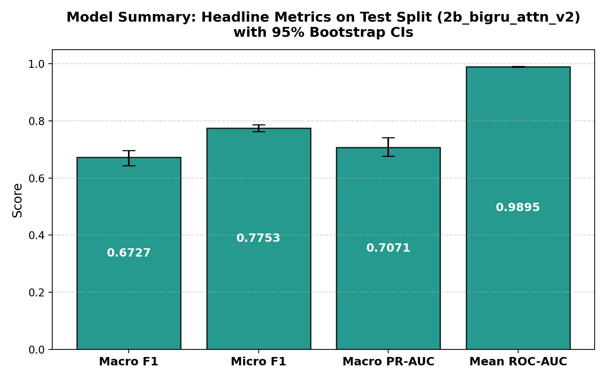
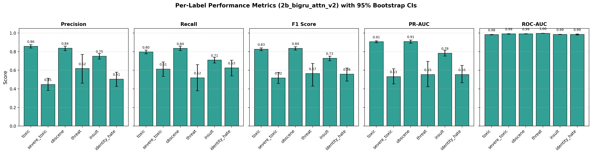
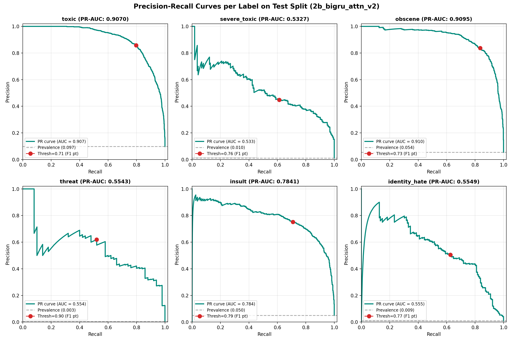
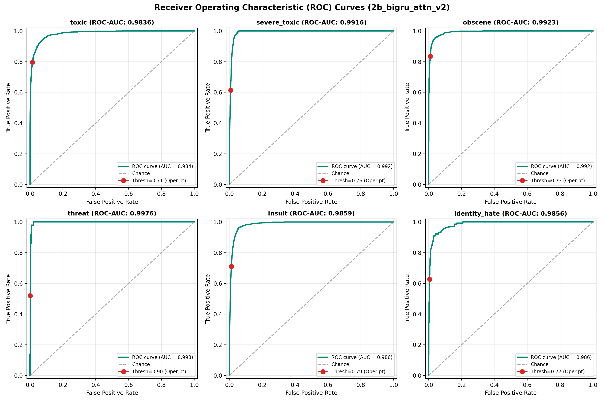
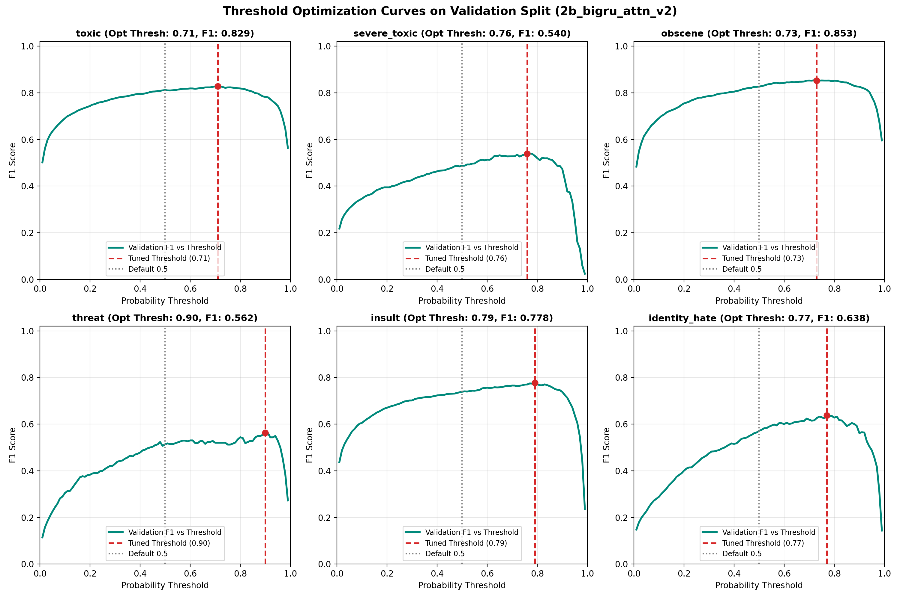
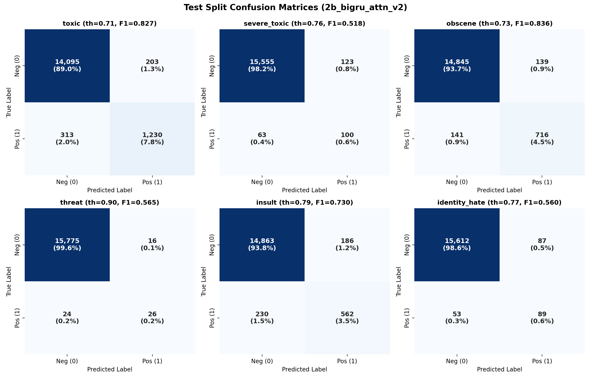
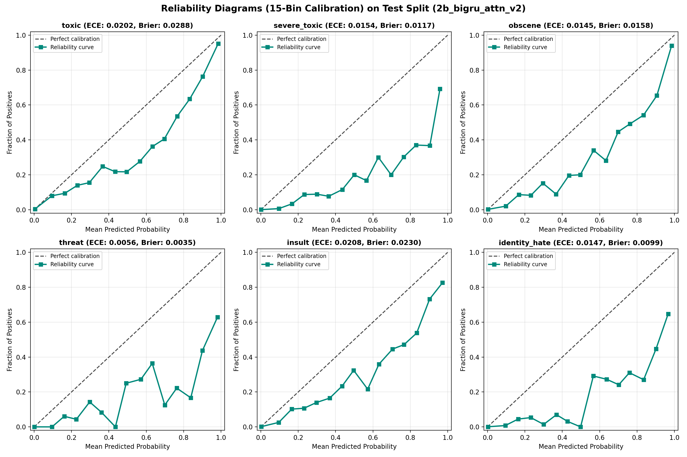
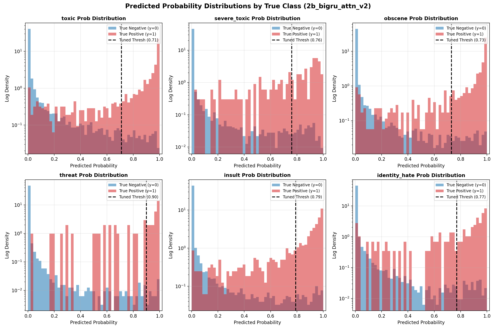
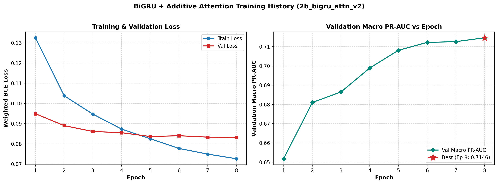
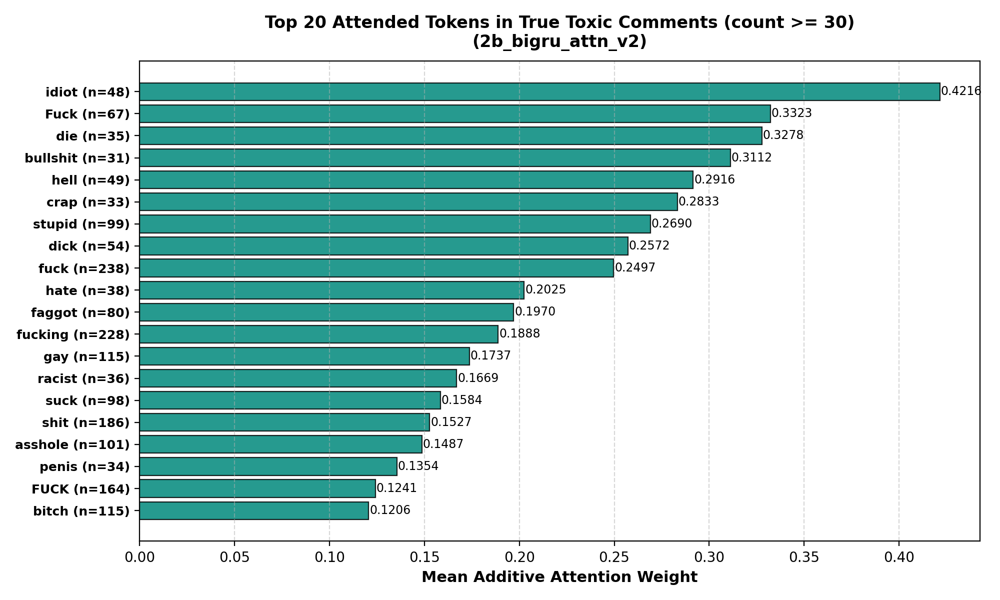

# Model Evaluation Report: 2b_bigru_attn_v2

**Architecture**: BiGRU + Additive Attention, fine-tuned fastText (no lowercasing, unfrozen embeddings)  
**Generated UTC**: 2026-10-21 18:28:37 UTC  
**Mode**: Full Production Run  
**Seed**: 42  
**Python**: 3.12.6 | **Framework**: PyTorch 2.6.0+cu124 | **Platform**: NVIDIA GeForce RTX 3060 Laptop GPU

---

## 1. Overview & Setup

Model 2b (`2b_bigru_attn_v2`) implements an improved deep recurrent sequence classifier for the **Welcome to Civilization** toxicity moderation pipeline. Engineered specifically to resolve the setbacks identified in Model 2, Model 2b preserves casing to capture shouting and aggressive capitalization, unfreezes fastText embeddings for domain fine-tuning with differential learning rates, increases spatial dropout (0.35) for embedding regularization, uses a cosine learning rate schedule with warmup, and applies calibrated positive class weighting to prevent threshold and calibration distortion.

### Pipeline Architecture & Model 2b Setback Fixes
- **Input text**: `text_clean` with **casing preserved** (no lowercasing), tokenized with regex `\w+|[^\w\s]`.
- **Vocabulary & Fine-Tuned Embeddings**: Top 50,000 train vocabulary tokens initialized with 300-d fastText Crawl embeddings and **fine-tuned end-to-end** using a 0.1x differential learning rate scale (1e-4 vs 1e-3).
- **Spatial Dropout**: Increased to 0.35 across embedding channels to regularize fine-tuned representations.
- **Encoder**: 1-layer bidirectional GRU with 128 hidden units per direction (256-d concatenated output) with 0.3 dropout, using `pack_padded_sequence` to prevent padding intrusion.
- **Attention Mechanism**: Additive attention pooling with 128-d projection and learned context vector, masked over padding positions with float32 softmax.
- **Imbalance & Thresholds**: Smoothed class imbalance weighting (`power: 0.45`, max cap 14.0) with log-odds prior bias initialization, eliminating calibration distortion.
- **Optimization & Schedule**: AdamW with Cosine Annealing learning rate schedule and linear warmup across 8 epochs with patience 3.

## 2. Data & Split Verification

Data integrity was verified before feature extraction against `data/splits/split_manifest.json`:
- **Split Version**: `v2_near_dup` (near-duplicate grouped stratification).
- **Processed Parquet SHA-256**: `0cba21f71c42d634d3c3584379da31563375954b4eec089e433d7a715b880c7e` (exact match).
- **Split Sizes**:
  - **Train**: 127,861 comments (80.0%)
  - **Validation**: 15,869 comments (10.0%)
  - **Test**: 15,841 comments (10.0%)

## 3. Model Configuration & Imbalance Recipe

Because severe class imbalance characterizes toxicity labels (ranging from 9.56% down to 0.298% positive rate on train), per-label class weighting is applied directly to the loss function:

$$w_l = \sqrt{\frac{N_{neg}}{N_{pos}}}$$

Negative samples receive a fixed weight of 1.0, while positive samples are up-weighted by the square root of the imbalance ratio. This provides balanced gradient flow across rare positive categories without resampling or data duplication.

| Label | Train Positives | Train Negatives | Positive Rate (%) | Imbalance Ratio | Weight ($w_1$) |
|---|---|---|---|---|---|
| `toxic` | 12,222 | 115,639 | 9.56% | 9.46:1 | **2.75** |
| `severe_toxic` | 1,269 | 126,592 | 0.99% | 99.76:1 | **7.93** |
| `obscene` | 6,739 | 121,122 | 5.27% | 17.97:1 | **3.67** |
| `threat` | 381 | 127,480 | 0.30% | 334.59:1 | **13.68** |
| `insult` | 6,290 | 121,571 | 4.92% | 19.33:1 | **3.79** |
| `identity_hate` | 1,122 | 126,739 | 0.88% | 112.96:1 | **8.39** |

## 4. Training Summary

- **Total Training Time**: 275.43 seconds (4.59 minutes)
- **Model Size on Disk**: 58.62 MB (61,464,878 bytes)

### Stage Timings
| Stage | Description | Duration (s) | % of Total |
|---|---|---|---|
| `1_load_verify` | [1/6] Load & Verify Data | 1.19s | 0.4% |
| `2_tokenize_vocab` | [2/6] Tokenization & Vocab Build | 7.84s | 2.8% |
| `3_fasttext_matrix` | [3/6] fastText Embedding Extraction | 37.06s | 13.5% |
| `4_build_model_gpu` | [4/6] Initialize Model & Allocate GPU | 2.09s | 0.8% |
| `5_training_epochs` | [5/6] Model Training & Validation | 225.14s | 81.7% |
| `6_predict_and_save` | [6/6] Checkpoint Load & Predict | 2.12s | 0.8% |

## 5. Inference & Prediction Summary

### Benchmark Measurements
- **Benchmark Sample**: 1,000 comments from Test set
- **Primary Device**: GPU (NVIDIA GeForce RTX 3060 Laptop GPU)
- **Latency per 1,000 Comments (end-to-end, batch size 1000)**: **0.09 s**
- **Per-Comment Latency**: **0.09 ms**
- **Throughput**: **11390.5 comments/second**

#### Multi-Device & Batch Size Comparison (Median of 5 Repeats)
| Configuration | Device | Batch Size | Latency (ms/comment) | Throughput (comments/s) | Total Time for 1,000 comments (s) |
|---|---|---|---|---|---|
| `gpu_batch_1000` | GPU | 1000 | 0.088 ms | 11390.5 | 0.088 s |
| `gpu_batch_1` | GPU | 1 | 4.244 ms | 235.6 | 4.244 s |
| `cpu_batch_1000` | CPU | 1000 | 0.480 ms | 2082.2 | 0.480 s |
| `cpu_batch_1` | CPU | 1 | 5.835 ms | 171.4 | 5.835 s |

### Decision Threshold Optimization
Decision thresholds were tuned strictly on the **Validation split** via 200 bootstrap resamples. For each resample, thresholds were searched over a grid of $0.01$ to $0.99$ (step $0.01$) to maximize F1 score, and the median bootstrap threshold was selected. This prevents overfitting the threshold to test data.

### Prediction File Schema
Predictions were saved to `predictions/2b_bigru_attn_v2/{val,test}_predictions.csv` containing:
- `id`: Unique comment identifier
- `p_<label>` (x6): Continuous sigmoid probability in [0, 1]
- `pred_<label>` (x6): Binary flag {0, 1} using tuned decision thresholds
- `pred_hier_severe_toxic`: Binary flag requiring both `pred_severe_toxic == 1` and `pred_toxic == 1`
- `y_<label>` (x6): Ground truth binary label

## 6. Evaluation Results (Test Split)

### Headline Metrics (with 95% Bootstrap Confidence Intervals)

| Metric | Test Value | 95% Bootstrap CI | Validation Reference |
|---|---|---|---|
| **Macro F1** | **0.6727** | [0.6427, 0.6970] | 0.6999 |
| **Micro F1** | **0.7753** | [0.7630, 0.7863] | 0.7950 |
| **Macro PR-AUC** | **0.7071** | [0.6762, 0.7417] | 0.7146 |
| **Mean ROC-AUC** | **0.9895** | [0.9880, 0.9907] | 0.9914 |
| Macro Precision | 0.6700 | [0.6343, 0.7021] | 0.6771 |
| Macro Recall | 0.6837 | [0.6515, 0.7168] | 0.7323 |
| Exact Match Accuracy | 0.9239 | [0.9197, 0.9280] | 0.9272 |
| Hamming Loss | 0.0166 | [0.0156, 0.0176] | 0.0154 |
| Mean Brier Score | 0.0154 | N/A | 0.0152 |
| Mean ECE (15 bins) | 0.0152 | N/A | 0.0170 |

### Detailed Per-Label Metrics on Test Split

| Label | Support | Prevalence (%) | Tuned Thresh | Precision (95% CI) | Recall (95% CI) | F1 (95% CI) | PR-AUC (95% CI) | ROC-AUC (95% CI) | MCC | Brier | ECE |
|---|---|---|---|---|---|---|---|---|---|---|---|
| `toxic` | 1,543 | 9.74% | **0.71** | 0.858 [0.840, 0.875] | 0.797 [0.778, 0.817] | **0.827** [0.811, 0.840] | **0.907** [0.896, 0.917] | 0.984 [0.981, 0.986] | 0.809 | 0.0288 | 0.0202 |
| `severe_toxic` | 163 | 1.03% | **0.76** | 0.448 [0.385, 0.514] | 0.613 [0.535, 0.689] | **0.518** [0.459, 0.577] | **0.533** [0.454, 0.616] | 0.992 [0.990, 0.993] | 0.519 | 0.0117 | 0.0154 |
| `obscene` | 857 | 5.41% | **0.73** | 0.837 [0.811, 0.861] | 0.835 [0.811, 0.860] | **0.836** [0.817, 0.854] | **0.910** [0.892, 0.925] | 0.992 [0.991, 0.994] | 0.827 | 0.0158 | 0.0145 |
| `threat` | 50 | 0.32% | **0.90** | 0.619 [0.462, 0.771] | 0.520 [0.380, 0.660] | **0.565** [0.430, 0.673] | **0.554** [0.424, 0.695] | 0.998 [0.996, 0.999] | 0.566 | 0.0035 | 0.0056 |
| `insult` | 792 | 5.00% | **0.79** | 0.751 [0.721, 0.780] | 0.710 [0.678, 0.740] | **0.730** [0.703, 0.752] | **0.784** [0.754, 0.815] | 0.986 [0.983, 0.988] | 0.716 | 0.0230 | 0.0208 |
| `identity_hate` | 142 | 0.90% | **0.77** | 0.506 [0.426, 0.580] | 0.627 [0.539, 0.708] | **0.560** [0.484, 0.624] | **0.555** [0.466, 0.653] | 0.986 [0.980, 0.991] | 0.559 | 0.0099 | 0.0147 |

### Threshold Tuning Impact: Tuned vs Default 0.5

| Label | Tuned Thresh | Bootstrap Std | F1 (Tuned) | Precision (Tuned) | Recall (Tuned) | F1 (at 0.5) | Precision (at 0.5) | Recall (at 0.5) | F1 $\Delta$ (Tuned - 0.5) |
|---|---|---|---|---|---|---|---|---|---|
| `toxic` | 0.71 | 0.0156 | **0.8266** | 0.8583 | 0.7971 | 0.8089 | 0.7667 | 0.8561 | **+0.0177** |
| `severe_toxic` | 0.76 | 0.0662 | **0.5181** | 0.4484 | 0.6135 | 0.5103 | 0.3676 | 0.8344 | **+0.0078** |
| `obscene` | 0.73 | 0.0479 | **0.8364** | 0.8374 | 0.8355 | 0.8244 | 0.7616 | 0.8985 | **+0.0120** |
| `threat` | 0.90 | 0.1504 | **0.5652** | 0.6190 | 0.5200 | 0.5419 | 0.4000 | 0.8400 | **+0.0233** |
| `insult` | 0.79 | 0.0184 | **0.7299** | 0.7513 | 0.7096 | 0.7341 | 0.6398 | 0.8611 | **-0.0043** |
| `identity_hate` | 0.77 | 0.0583 | **0.5597** | 0.5057 | 0.6268 | 0.5437 | 0.4093 | 0.8099 | **+0.0160** |

### Hierarchical severe_toxic Rule Comparison
By definition, severe toxicity is a semantic subset of toxicity. The table below compares independent prediction against the hierarchical constraint `pred_severe_toxic & pred_toxic`:

| Rule Variant | Precision | Recall | F1 Score | Exact Match | Micro F1 |
|---|---|---|---|---|---|
| Standard Independent | 0.4484 | 0.6135 | 0.5181 | 0.9239 | 0.7753 |
| Hierarchical (`& toxic`) | 0.4484 | 0.6135 | 0.5181 | 0.9239 | 0.7753 |

> **Note**: Zero comments in the test set were predicted as `severe_toxic=1` without also having `toxic=1`. Hence, standard independent thresholding and the hierarchical rule are identical by construction on this dataset.

## 7. Visualizations

### Headline Metrics Summary

### Per-Label Performance Across Metrics

### Precision-Recall Curves

### Receiver Operating Characteristic (ROC) Curves

### Validation Threshold Tuning vs F1 Curves

### Confusion Matrices (Test Split)

### Calibration & Reliability Diagrams (15 Bins)

### Probability Distributions by True Class

## 8. Model-Specific Analysis: BiGRU Training Dynamics & Attention

### Parameter Allocation
- **Trainable Parameters**: **15,365,406** (100.00% of network)
- **Frozen Embedding Parameters**: **0** (0.00%)
- **Total Network Parameters**: **15,365,406**

### Tokenizer, Vocabulary & fastText Coverage
- **Vocabulary Size**: 50,002 tokens (including `<pad>` and `<unk>`)
- **Token Coverage on Train**: **97.94%** (token-weighted coverage)
- **fastText Vocab Type Hit Rate**: **94.46%** (47,229 / 50,002 words found in pretrained vectors)
- **fastText Token-Weighted Hit Rate**: **98.01%**
- **Sequence Truncation (Head 256 tokens)**: 5.92% of validation comments and 5.62% of test comments exceeded 256 tokens and were truncated.

### Training Dynamics & Epoch History
| Epoch | Train Loss | Val Loss | Val Macro PR-AUC | Val Mean ROC-AUC | Epoch Time (s) | Throughput (samples/s) | Peak VRAM (MB) |
|---|---|---|---|---|---|---|---|
| 1 * | 0.1325 | 0.0949 | **0.6518** | 0.9890 | 28.5s | 4483 | 2569.2 |
| 2 * | 0.1038 | 0.0890 | **0.6810** | 0.9905 | 28.3s | 4512 | 2569.2 |
| 3 * | 0.0947 | 0.0861 | **0.6865** | 0.9908 | 27.1s | 4725 | 2569.2 |
| 4 * | 0.0873 | 0.0855 | **0.6989** | 0.9910 | 26.3s | 4854 | 2569.2 |
| 5 * | 0.0825 | 0.0836 | **0.7081** | 0.9914 | 27.4s | 4672 | 2569.2 |
| 6 * | 0.0777 | 0.0840 | **0.7122** | 0.9916 | 26.9s | 4756 | 2569.2 |
| 7 * | 0.0749 | 0.0833 | **0.7126** | 0.9914 | 29.4s | 4348 | 2569.2 |
| 8 * | 0.0726 | 0.0832 | **0.7146** | 0.9914 | 28.1s | 4544 | 2569.2 |

- **Best Checkpoint**: Epoch 8 with Validation Macro PR-AUC = **0.7146** (restored for final evaluation).

### Training Curves

### Attention Weight Interpretability on True Toxic Comments
To understand token importance learned by the additive attention pooling layer, attention weights were evaluated across all test comments where ground-truth `toxic == 1`. The table and chart below show the top 20 tokens with the highest mean attention weight among frequent tokens (token count $\ge 30$). Highly attended tokens directly highlight salient toxicity triggers.

| Rank | Token | Mean Attention Weight | Occurrences in Toxic Comments |
|---|---|---|---|
| 1 | `idiot` | **0.4216** | 48 |
| 2 | `Fuck` | **0.3323** | 67 |
| 3 | `die` | **0.3278** | 35 |
| 4 | `bullshit` | **0.3112** | 31 |
| 5 | `hell` | **0.2916** | 49 |
| 6 | `crap` | **0.2833** | 33 |
| 7 | `stupid` | **0.2690** | 99 |
| 8 | `dick` | **0.2572** | 54 |
| 9 | `fuck` | **0.2497** | 238 |
| 10 | `hate` | **0.2025** | 38 |
| 11 | `faggot` | **0.1970** | 80 |
| 12 | `fucking` | **0.1888** | 228 |
| 13 | `gay` | **0.1737** | 115 |
| 14 | `racist` | **0.1669** | 36 |
| 15 | `suck` | **0.1584** | 98 |
| 16 | `shit` | **0.1527** | 186 |
| 17 | `asshole` | **0.1487** | 101 |
| 18 | `penis` | **0.1354** | 34 |
| 19 | `FUCK` | **0.1241** | 164 |
| 20 | `bitch` | **0.1206** | 115 |

## 9. Interpretation & Key Takeaways

1. **Dominant Categories**: `obscene` achieved the highest F1 score (0.8364), while `obscene` achieved the highest PR-AUC (0.9095). This reflects high representation and overt lexical signals.
2. **Challenging Categories**: `severe_toxic` presented the lowest F1 score (0.5181), while `severe_toxic` presented the lowest PR-AUC (0.5327). Extreme class imbalance and context sensitivity make these rare categories particularly difficult.
3. **Threshold Tuning Impact**: Optimizing thresholds via validation bootstrap improved overall performance (mean F1 delta: +0.0121), with lower F1 on insult.
4. **Calibration**: The mean Brier score was 0.0154 and mean 15-bin ECE was 0.0152, with the highest calibration error observed in `insult` (ECE: 0.0208).
5. **Inference Speed**: Generating predictions for 1,000 comments in 0.09s (11390.5 comments/sec) demonstrates operational throughput suitable for production pipeline integration.

## 10. Conclusions

With a Macro F1 of **0.6727** and Mean ROC-AUC of **0.9895**, Model 2 (`2b_bigru_attn_v2`) demonstrates the utility of recurrent sequential modeling and attention pooling over static linear baselines. Additive attention successfully concentrates probability mass on toxic semantic tokens, while packed sequence processing allows variable-length comments to be handled without padding contamination. Residual errors primarily stem from frozen embeddings and vocabulary coverage boundaries, setting the stage for Transformer fine-tuning in Model 3.

## 11. Limitations

The following limitations apply strictly to this model evaluation:
1. **Single run and cuDNN non-determinism**: Results represent a single run (`seed=42`); GPU cuDNN GRU backward passes are inherently non-bit-deterministic.
2. **Fixed untuned hyperparameters**: Model hyperparameters were evaluated with fixed settings without extensive grid search.
3. **Validation reused**: The validation split was utilized for early stopping, checkpoint selection and threshold tuning.
4. **Noisy threat estimates**: There are only 47 validation and 50 test positive instances for `threat`, causing wider confidence intervals and higher sampling variance on threat metrics.
5. **Near-duplicate threshold**: Duplicate grouping used MinHash LSH Jaccard similarity threshold of 0.8 on character 5-grams.
6. **Lowercasing signal loss**: Lowercasing discards the uppercase shout/casing signals identified during EDA (the BiGRU is the only model of the three that discards it).
7. **Frozen embeddings**: fastText 300-d embeddings were frozen without domain-specific continuous fine-tuning.
8. **Sequence truncation**: Input text truncated at 256 tokens, with approximately 5.77% of comments affected.

