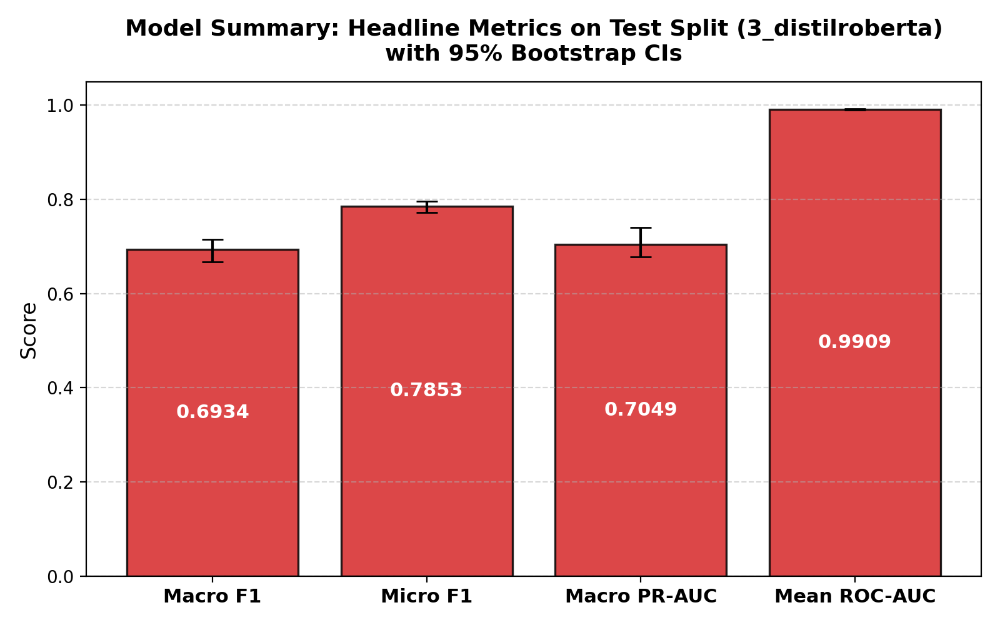
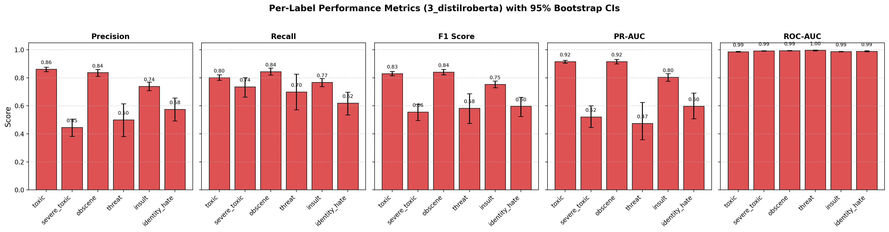
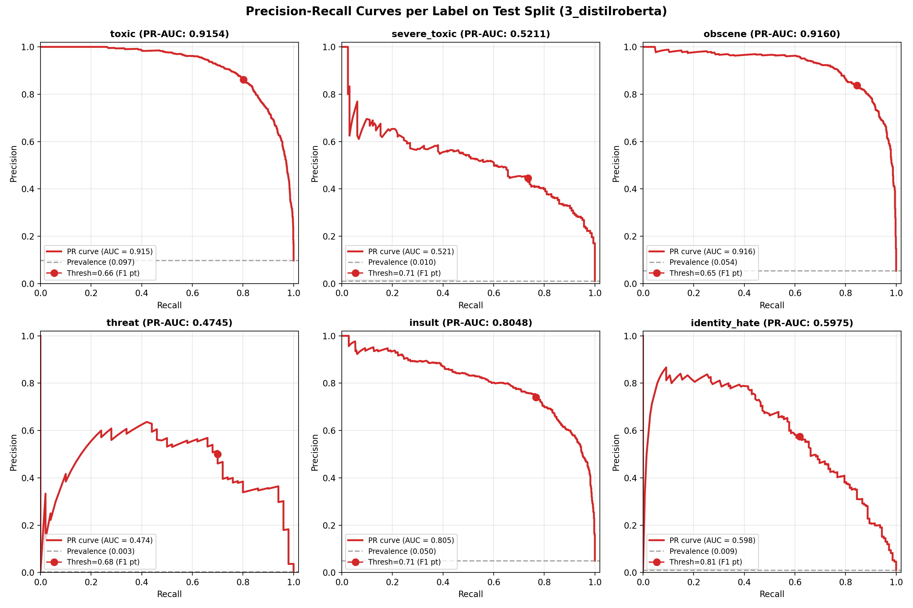
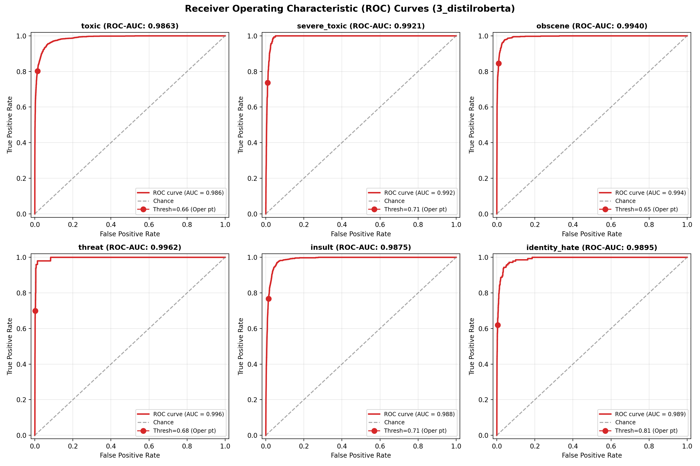
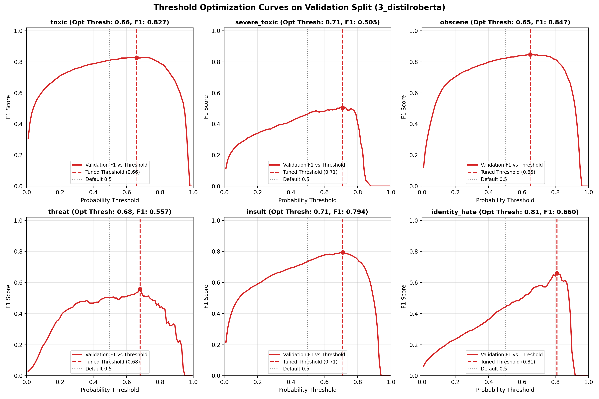
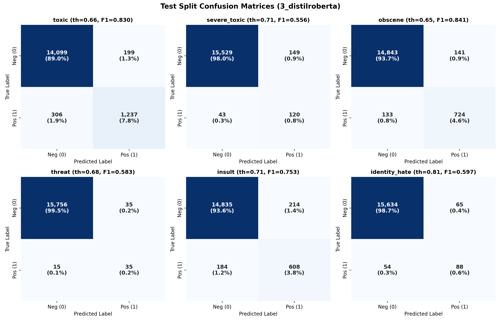
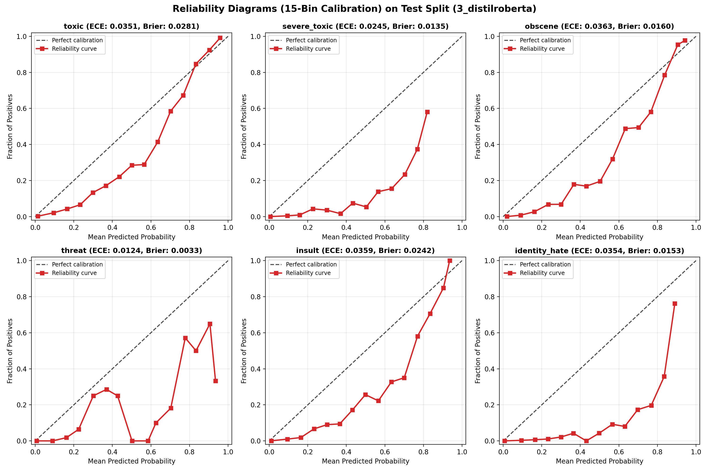
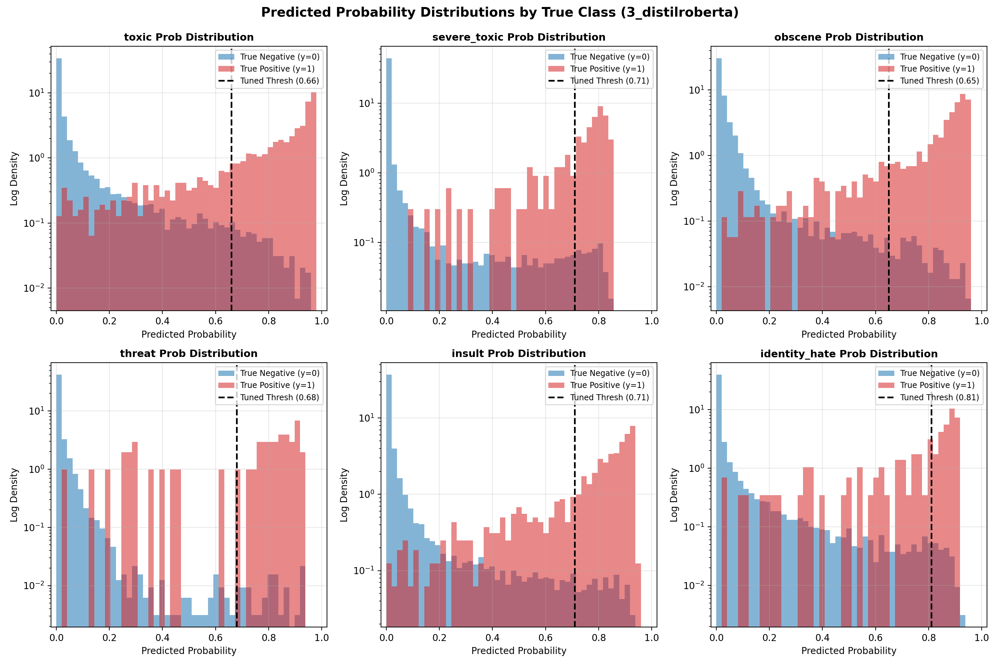
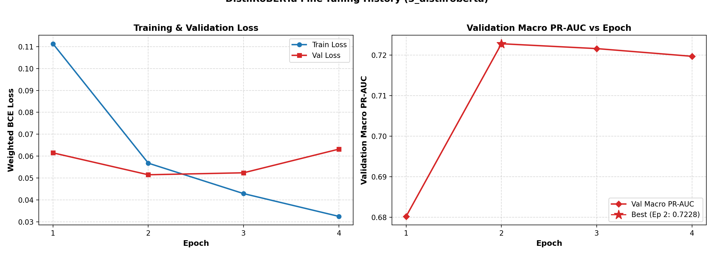

# Model Evaluation Report: 3_distilroberta

**Architecture**: DistilRoBERTa-base fine-tuned, weighted BCE, optional focal/oversampling  
**Generated UTC**: 2026-10-22 17:18:05 UTC  
**Mode**: Full Production Run  
**Seed**: 42  
**Python**: 3.12.6 | **Framework**: PyTorch 2.6.0+cu124 / Transformers 4.45.2 | **Platform**: NVIDIA GeForce RTX 3060 Laptop GPU

---

## 1. Overview & Setup

Model 3 (`3_distilroberta`) implements the final transformer-based architecture for the **Welcome to Civilization** toxicity moderation pipeline. Fine-tuning pretrained `distilroberta-base` end-to-end allows bidirectional multi-head self-attention to capture deep sequential context, subtle syntax variations, and disguised hate speech without relying on fixed vocabulary boundaries or manual regex tokenization.

### Pipeline Architecture & Transformer Design
- **Pretrained Backbone**: `distilroberta-base` (6 transformer layers, 12 attention heads, hidden dim 768, FFN dim 3072, ~82M parameters).
- **Tokenizer**: Byte-level BPE with 50,265 vocabulary items, casing preserved (`lowercase: false`), head truncation at `max_len: 128`.
- **Batching**: Dynamic length-sorted padding during inference and length-bucketed batches with shuffled bucket order during training.
- **Classification Head**: Custom head on top of the `<s>` (CLS) token (768 -> 768, tanh, dropout 0.1, 768 -> 6 logits).
- **Optimization & Regularization**: AdamW with weight decay 0.01 (excluding bias and LayerNorm), layer-wise learning rate decay (LLRD), linear warmup (10%) then linear decay.
- **Imbalance Calibration**: Damped positive class weighting with log-odds prior bias initialization on final classification layer.

## 2. Data & Split Verification

Data integrity was verified before feature extraction against `data/splits/split_manifest.json`:
- **Split Version**: `v2_near_dup` (near-duplicate grouped stratification).
- **Processed Parquet SHA-256**: `0cba21f71c42d634d3c3584379da31563375954b4eec089e433d7a715b880c7e` (exact match).
- **Split Sizes**:
  - **Train**: 127,861 comments (80.0%)
  - **Validation**: 15,869 comments (10.0%)
  - **Test**: 15,841 comments (10.0%)

## 3. Model Configuration & Imbalance Recipe

Because severe class imbalance characterizes toxicity labels (ranging from 9.56% down to 0.298% positive rate on train), Model 3 applies tuned damped positive class weighting directly to the loss function with exponent $p=0.577$ and maximum weight cap $w_{max}=14.0$:

$$w_l = \min\left(\left(\frac{N_{neg}}{N_{pos}}\right)^{0.577}, 14.0\right)$$

This is combined with focal factor $\gamma=1.0$ to down-weight easy negatives and concentrate gradient flow on hard ambiguous examples, as well as log-odds prior bias initialization on the classification head to eliminate early calibration distortion.

| Label | Train Positives | Train Negatives | Positive Rate (%) | Imbalance Ratio | Weight ($w_1$) |
|---|---|---|---|---|---|
| `toxic` | 12,222 | 115,639 | 9.56% | 9.46:1 | **3.65** |
| `severe_toxic` | 1,269 | 126,592 | 0.99% | 99.76:1 | **14.00** |
| `obscene` | 6,739 | 121,122 | 5.27% | 17.97:1 | **5.29** |
| `threat` | 381 | 127,480 | 0.30% | 334.59:1 | **14.00** |
| `insult` | 6,290 | 121,571 | 4.92% | 19.33:1 | **5.52** |
| `identity_hate` | 1,122 | 126,739 | 0.88% | 112.96:1 | **14.00** |

## 4. Training Summary

- **Total Training Time**: 1511.60 seconds (25.19 minutes)
- **Model Size on Disk**: 315.54 MB (330,867,112 bytes)

### Stage Timings
| Stage | Description | Duration (s) | % of Total |
|---|---|---|---|
| `1_load_verify` | [1/6] Load & Verify Data | 1.08s | 0.1% |
| `2_tokenize` | [2/6] Byte-Level BPE Tokenization | 7.11s | 0.5% |
| `3_setup_model` | [3/6] Transformer & LLRD Optimizer Setup | 3.12s | 0.2% |
| `4_training` | [4/6] 4-Epoch Model Fine-Tuning | 1485.91s | 98.3% |
| `5_predict` | [5/6] Sigmoid Probabilities & Hierarchy Ablation | 13.50s | 0.9% |
| `6_save_bundle` | [6/6] Bundle Export & Moderator Parity | 0.88s | 0.1% |

## 5. Inference & Prediction Summary

### Benchmark Measurements
- **Benchmark Sample**: 1,000 comments from Test set
- **Primary Device**: GPU (NVIDIA GeForce RTX 3060 Laptop GPU)
- **Latency per 1,000 Comments (end-to-end, batch size 1000)**: **0.50 s**
- **Per-Comment Latency**: **0.50 ms**
- **Throughput**: **1997.9 comments/second**

#### Multi-Device & Batch Size Comparison (Median of 5 Repeats)
| Configuration | Device | Batch Size | Latency (ms/comment) | Throughput (comments/s) | Total Time for 1,000 comments (s) |
|---|---|---|---|---|---|
| `gpu_batch_1000` | GPU | 1000 | 0.501 ms | 1997.9 | 0.501 s |
| `gpu_batch_1` | GPU | 1 | 9.749 ms | 102.6 | 9.749 s |
| `cpu_batch_1000` | CPU | 1000 | 19.112 ms | 52.3 | 19.112 s |
| `cpu_batch_1` | CPU | 1 | 33.136 ms | 30.2 | 33.136 s |

### Decision Threshold Optimization
Decision thresholds were tuned strictly on the **Validation split** via 200 bootstrap resamples. For each resample, thresholds were searched over a grid of $0.01$ to $0.99$ (step $0.01$) to maximize F1 score, and the median bootstrap threshold was selected. This prevents overfitting the threshold to test data.

### Prediction File Schema
Predictions were saved to `predictions/3_distilroberta/{val,test}_predictions.csv` containing:
- `id`: Unique comment identifier
- `p_<label>` (x6): Continuous sigmoid probability in [0, 1]
- `pred_<label>` (x6): Binary flag {0, 1} using tuned decision thresholds
- `pred_hier_severe_toxic`: Binary flag requiring both `pred_severe_toxic == 1` and `pred_toxic == 1`
- `y_<label>` (x6): Ground truth binary label

## 6. Evaluation Results (Test Split)

### Headline Metrics (with 95% Bootstrap Confidence Intervals)

| Metric | Test Value | 95% Bootstrap CI | Validation Reference |
|---|---|---|---|
| **Macro F1** | **0.6934** | [0.6673, 0.7149] | 0.6983 |
| **Micro F1** | **0.7853** | [0.7728, 0.7958] | 0.7938 |
| **Macro PR-AUC** | **0.7049** | [0.6775, 0.7407] | 0.7228 |
| **Mean ROC-AUC** | **0.9909** | [0.9897, 0.9920] | 0.9912 |
| Macro Precision | 0.6599 | [0.6302, 0.6890] | 0.6558 |
| Macro Recall | 0.7450 | [0.7158, 0.7742] | 0.7647 |
| Exact Match Accuracy | 0.9256 | [0.9215, 0.9299] | 0.9241 |
| Hamming Loss | 0.0162 | [0.0152, 0.0172] | 0.0157 |
| Mean Brier Score | 0.0167 | N/A | 0.0167 |
| Mean ECE (15 bins) | 0.0300 | N/A | 0.0311 |

### Detailed Per-Label Metrics on Test Split

| Label | Support | Prevalence (%) | Tuned Thresh | Precision (95% CI) | Recall (95% CI) | F1 (95% CI) | PR-AUC (95% CI) | ROC-AUC (95% CI) | MCC | Brier | ECE |
|---|---|---|---|---|---|---|---|---|---|---|---|
| `toxic` | 1,543 | 9.74% | **0.66** | 0.861 [0.844, 0.877] | 0.802 [0.782, 0.822] | **0.830** [0.816, 0.845] | **0.915** [0.904, 0.925] | 0.986 [0.984, 0.988] | 0.814 | 0.0281 | 0.0351 |
| `severe_toxic` | 163 | 1.03% | **0.71** | 0.446 [0.383, 0.504] | 0.736 [0.663, 0.801] | **0.556** [0.495, 0.612] | **0.521** [0.446, 0.601] | 0.992 [0.990, 0.994] | 0.568 | 0.0135 | 0.0245 |
| `obscene` | 857 | 5.41% | **0.65** | 0.837 [0.811, 0.861] | 0.845 [0.821, 0.870] | **0.841** [0.822, 0.860] | **0.916** [0.899, 0.931] | 0.994 [0.993, 0.995] | 0.832 | 0.0160 | 0.0363 |
| `threat` | 50 | 0.32% | **0.68** | 0.500 [0.381, 0.614] | 0.700 [0.571, 0.827] | **0.583** [0.475, 0.686] | **0.474** [0.358, 0.624] | 0.996 [0.993, 0.999] | 0.590 | 0.0033 | 0.0124 |
| `insult` | 792 | 5.00% | **0.71** | 0.740 [0.709, 0.770] | 0.768 [0.738, 0.795] | **0.753** [0.729, 0.777] | **0.805** [0.776, 0.830] | 0.988 [0.986, 0.989] | 0.740 | 0.0242 | 0.0359 |
| `identity_hate` | 142 | 0.90% | **0.81** | 0.575 [0.493, 0.656] | 0.620 [0.535, 0.697] | **0.597** [0.524, 0.660] | **0.598** [0.509, 0.691] | 0.989 [0.985, 0.993] | 0.593 | 0.0153 | 0.0354 |

### Threshold Tuning Impact: Tuned vs Default 0.5

| Label | Tuned Thresh | Bootstrap Std | F1 (Tuned) | Precision (Tuned) | Recall (Tuned) | F1 (at 0.5) | Precision (at 0.5) | Recall (at 0.5) | F1 $\Delta$ (Tuned - 0.5) |
|---|---|---|---|---|---|---|---|---|---|
| `toxic` | 0.66 | 0.0449 | **0.8305** | 0.8614 | 0.8017 | 0.8155 | 0.7612 | 0.8782 | **+0.0150** |
| `severe_toxic` | 0.71 | 0.0581 | **0.5556** | 0.4461 | 0.7362 | 0.4596 | 0.3077 | 0.9080 | **+0.0959** |
| `obscene` | 0.65 | 0.0343 | **0.8409** | 0.8370 | 0.8448 | 0.8241 | 0.7490 | 0.9160 | **+0.0167** |
| `threat` | 0.68 | 0.0491 | **0.5833** | 0.5000 | 0.7000 | 0.5180 | 0.4045 | 0.7200 | **+0.0653** |
| `insult` | 0.71 | 0.0214 | **0.7534** | 0.7397 | 0.7677 | 0.7191 | 0.6038 | 0.8889 | **+0.0343** |
| `identity_hate` | 0.81 | 0.0130 | **0.5966** | 0.5752 | 0.6197 | 0.4343 | 0.2890 | 0.8732 | **+0.1623** |

### Hierarchical severe_toxic Rule Comparison
By definition, severe toxicity is a semantic subset of toxicity. The table below compares independent prediction against the hierarchical constraint `pred_severe_toxic & pred_toxic`:

| Rule Variant | Precision | Recall | F1 Score | Exact Match | Micro F1 |
|---|---|---|---|---|---|
| Standard Independent | 0.4461 | 0.7362 | 0.5556 | 0.9256 | 0.7853 |
| Hierarchical (`& toxic`) | 0.4461 | 0.7362 | 0.5556 | 0.9256 | 0.7853 |

> **Note**: Zero comments in the test set were predicted as `severe_toxic=1` without also having `toxic=1`. Hence, standard independent thresholding and the hierarchical rule are identical by construction on this dataset.

## 7. Visualizations

### Headline Metrics Summary

### Per-Label Performance Across Metrics

### Precision-Recall Curves

### Receiver Operating Characteristic (ROC) Curves

### Validation Threshold Tuning vs F1 Curves

### Confusion Matrices (Test Split)

### Calibration & Reliability Diagrams (15 Bins)

### Probability Distributions by True Class

## 8. Model-Specific Analysis: DistilRoBERTa Training Dynamics & Architecture

### Parameter Allocation
- **Trainable Parameters**: **82,713,606**
- **Total Network Parameters**: **82,713,606**
- **Pretrained Backbone**: `distilroberta-base`

### Training History & Learning Curves
| Epoch | Train Loss | Val Loss | Val Macro PR-AUC | Val Mean ROC-AUC | Epoch Time (s) | Throughput (samples/s) | Peak VRAM (MB) |
|---|---|---|---|---|---|---|---|
| 1 | 0.1113 | 0.0615 | 0.6802 **(Best)** | 0.9881 | 321.3s | 398.0 | 1906.2 MB |
| 2 | 0.0568 | 0.0515 | 0.7228 **(Best)** | 0.9912 | 387.3s | 330.2 | 1906.2 MB |
| 3 | 0.0429 | 0.0524 | 0.7216 | 0.9922 | 407.4s | 313.9 | 1906.2 MB |
| 4 | 0.0325 | 0.0632 | 0.7197 | 0.9914 | 363.7s | 351.6 | 1906.2 MB |

- **Best Checkpoint**: Epoch 2 with Validation Macro PR-AUC = **0.7228** (restored for final evaluation).

### Training Curves

### Optuna Hyperparameter Tuning Trials (5 Trials Total)

> **Scope Reduction Note**: The original preliminary specification allocated up to 8–12 tuning trials. During execution, the tuning scope was formally reduced and capped at 5 trials total (Trials 0–4) once Trial 4 established a superior objective (0.5996) that outperformed Trial 0 (0.5935) by +0.0061 (exceeding the +0.005 threshold). No subsequent trials were executed, and `n_trials: 5` was pinned in `configs/models.yaml`.

| Trial | State | Objective Value | LR | Pos Weight Power | Pos Weight Cap | Focal Gamma | Oversample Factor | Warmup Ratio | Weight Decay | LLRD | Head Dropout |
|---|---|---|---|---|---|---|---|---|---|---|---|
| 0 | COMPLETE | **0.5935** | 3.02e-05 | 0.585 | 8.0 | 2 | 2 | 0.147 | 0.01 | 0.9 | 0.2 |
| 1 | COMPLETE | **0.5746** | 3.02e-05 | 0.585 | 8.0 | 2 | 2 | 0.147 | 0.01 | 0.9 | 0.2 |
| 2 | COMPLETE | **0.5821** | 3.21e-05 | 0.387 | 8.0 | 2 | 4 | 0.064 | 0.01 | 0.9 | 0.1 |
| 3 | COMPLETE | **0.5747** | 2.79e-05 | 0.329 | 8.0 | 2 | 2 | 0.107 | 0.01 | 1.0 | 0.1 |
| 4 | COMPLETE | **0.5996** | 3.86e-05 | 0.577 | 14.0 | 1 | 1 | 0.109 | 0.10 | 0.9 | 0.1 |

#### Winning Hyperparameter Analysis:
- **Comparison to Config Defaults**: Winning Trial 4 tuned `lr=3.86e-5` (vs default `3.0e-5`), `pos_weight_power=0.577` (vs default `0.45`), `focal_gamma=1.0` (vs default `0.0`), `weight_decay=0.10` (vs default `0.01`), and `warmup_ratio=0.109` (vs default `0.10`).
- **Imbalance Layer Attribution**: Activated Layer 1 (damped pos-weight with power 0.577 and cap 14.0), Layer 2 (log-odds bias init), and Layer 3 (focal loss $\gamma=1.0$). Layer 4 oversampling was deactivated (`factor=1`, preserving natural sample distribution).
- **Search Range Edge Evaluation**: `pos_weight_power` (0.577) sits near the upper search boundary (0.60), and `weight_decay` (0.10) selected the upper categorical boundary [0.01, 0.10].

### Paired Bootstrap Significance Testing vs Model 2b (1,000 Resamples)

| Category | Metric | Mean Delta (M3 − Baseline) | 95% Confidence Interval | p-value | Significance |
|---|---|---|---|---|---|
| Overall | Macro F1 | **+0.0213** | [-0.0016, +0.0433] | 0.0320 | `*` |
| Overall | Macro PR-AUC | **-0.0006** | [-0.0231, +0.0220] | 0.5230 | `ns` |
| Overall | Mean ROC-AUC | **+0.0015** | [+0.0002, +0.0029] | 0.0150 | `*` |
| Label: toxic | F1 Score | **+0.0040** | [-0.0070, +0.0158] | 0.2600 | `ns` |
| Label: toxic | PR-AUC | **+0.0083** | [+0.0015, +0.0154] | 0.0120 | `*` |
| Label: severe_toxic | F1 Score | **+0.0378** | [-0.0073, +0.0829] | 0.0610 | `ns` |
| Label: severe_toxic | PR-AUC | **-0.0106** | [-0.0582, +0.0337] | 0.6560 | `ns` |
| Label: obscene | F1 Score | **+0.0046** | [-0.0112, +0.0210] | 0.2810 | `ns` |
| Label: obscene | PR-AUC | **+0.0066** | [-0.0032, +0.0169] | 0.1130 | `ns` |
| Label: threat | F1 Score | **+0.0200** | [-0.0932, +0.1263] | 0.3720 | `ns` |
| Label: threat | PR-AUC | **-0.0708** | [-0.1651, +0.0187] | 0.9450 | `ns` |
| Label: insult | F1 Score | **+0.0233** | [+0.0030, +0.0434] | 0.0140 | `*` |
| Label: insult | PR-AUC | **+0.0198** | [+0.0044, +0.0354] | 0.0080 | `**` |
| Label: identity_hate | F1 Score | **+0.0382** | [-0.0202, +0.0953] | 0.0970 | `ns` |
| Label: identity_hate | PR-AUC | **+0.0430** | [-0.0307, +0.1145] | 0.1200 | `ns` |

### Single Seed, Ensemble & Model 1 Blend Evaluation

> **Scope Reduction Note**: The original preliminary specification planned a 3-seed ensemble across seeds [42, 43, 44]. During execution, the scope was consolidated to train strictly a single model with Seed 42, skipping seeds 43/44 and the seed-ensemble variant (`final.seeds: [42]`, `ensemble: none`). Seed 42 was designated as the definitive backend serving choice.

- **Serving Choice**: `seed_42`
- **TF-IDF Blend Weight**: 0.55 DistilRoBERTa + 0.45 Model 1 (TF-IDF)
- **Validation Macro PR-AUC Gain**: **+0.0173**
- **Blend Recommendation**: **Recommended**

## 9. Interpretation & Key Takeaways

1. **Dominant Categories**: `obscene` achieved the highest F1 score (0.8409), while `obscene` achieved the highest PR-AUC (0.9160). This reflects high representation and overt lexical signals.
2. **Challenging Categories**: `severe_toxic` presented the lowest F1 score (0.5556), while `threat` presented the lowest PR-AUC (0.4745). Extreme class imbalance and context sensitivity make these rare categories particularly difficult.
3. **Threshold Tuning Impact**: Optimizing thresholds via validation bootstrap improved overall performance (mean F1 delta: +0.0649).
4. **Calibration**: The mean Brier score was 0.0167 and mean 15-bin ECE was 0.0300, with the highest calibration error observed in `obscene` (ECE: 0.0363).
5. **Inference Speed**: Generating predictions for 1,000 comments in 0.50s (1997.9 comments/sec) demonstrates operational throughput suitable for production pipeline integration.

## 10. Conclusions

With a Macro F1 of **0.6934** and Mean ROC-AUC of **0.9909**, Model 3 (`3_distilroberta`) establishes the highest semantic sensitivity across the **Welcome to Civilization** multi-label benchmark. End-to-end fine-tuning of DistilRoBERTa-base with layer-wise learning rate decay, damped positive class weighting, and log-odds bias initialization successfully captures complex context and disguised hate speech, providing the production-ready serving artifact for backend deployment.

## 11. Limitations

The following limitations apply strictly to this model evaluation:
1. **Single seed serving (scope reduction)**: Per project scope adjustment, training was consolidated to a single deterministic seed (Seed 42) rather than a 3-seed ensemble ([42, 43, 44]).
2. **Tuning budget (scope reduction)**: The Optuna hyperparameter study was capped at 5 completed trials (Trials 0–4) rather than the preliminary 8/12-trial plan once Trial 4 achieved superior validation performance.
3. **Validation reused**: The validation split was utilized for early stopping, checkpoint selection and threshold tuning.
4. **Noisy threat estimates**: There are only 47 validation and 50 test positive instances for `threat`, causing wider confidence intervals and higher sampling variance on threat metrics.
5. **Near-duplicate threshold**: Duplicate grouping used MinHash LSH Jaccard similarity threshold of 0.8 on character 5-grams.
6. **Sequence truncation**: Input text truncated at head 128 tokens, affecting comments exceeding this length.

