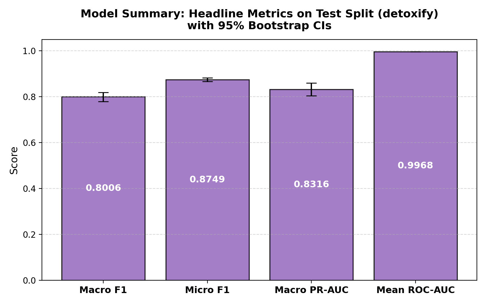
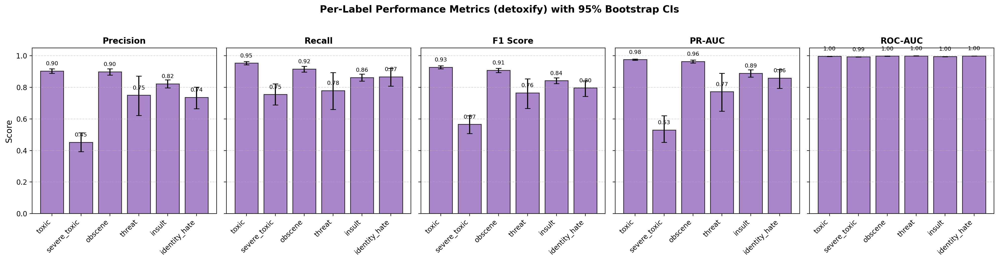
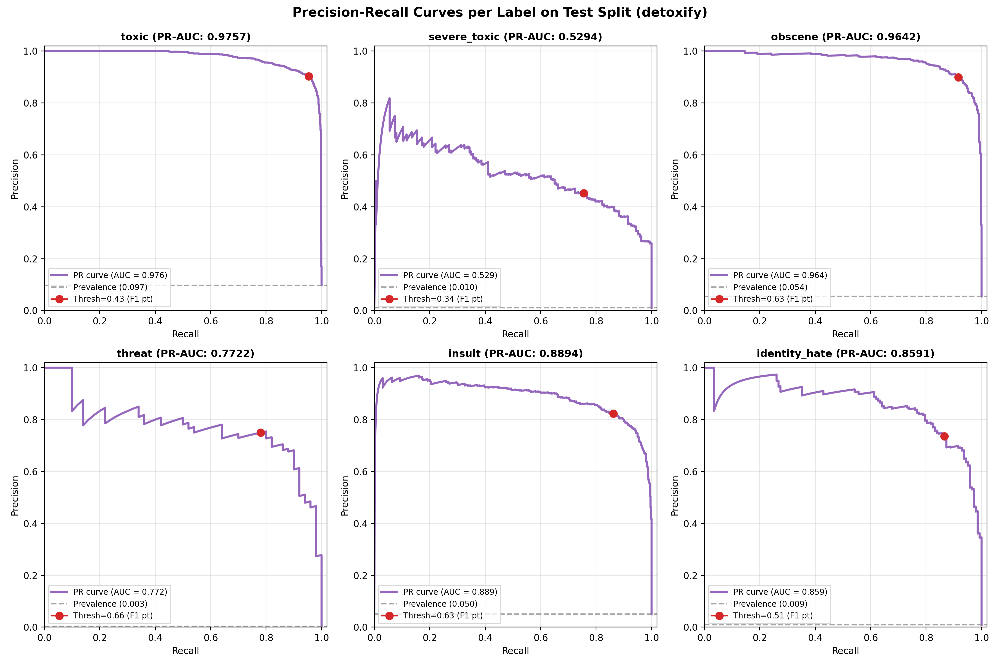
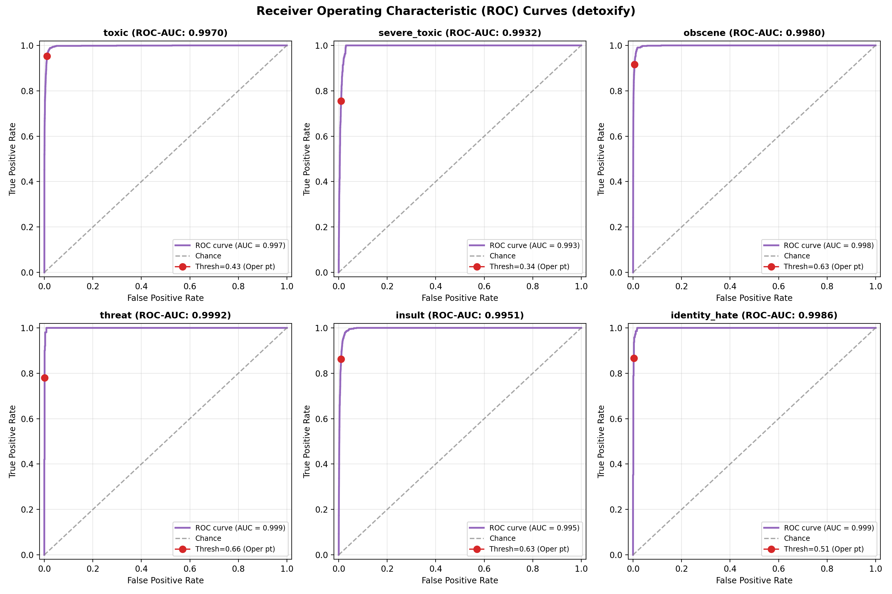
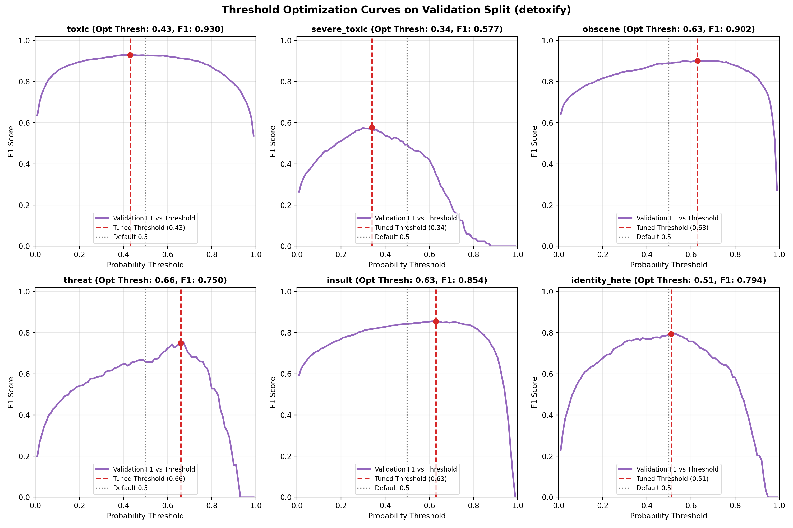
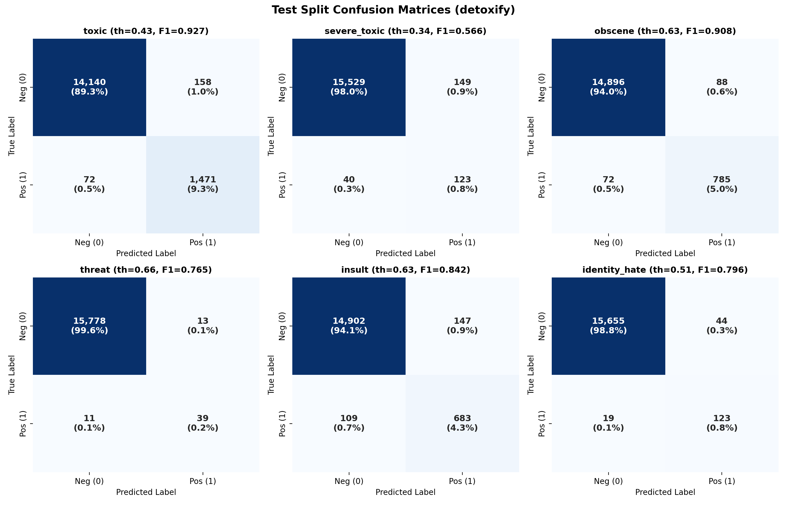
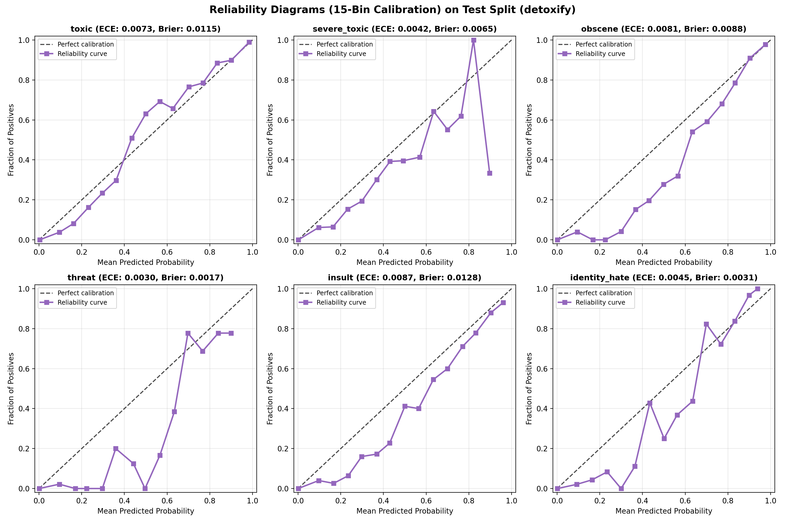
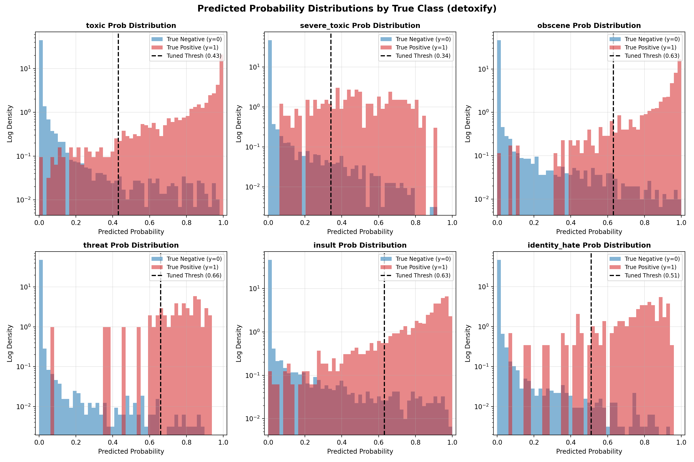

# Model Evaluation Report: detoxify

**Architecture**: Detoxify Original (BERT-base Pretrained Baseline)  
**Generated UTC**: 2026-10-22 18:51:38 UTC  
**Mode**: Full Production Run  
**Seed**: 42  
**Python**: 3.12.6 | **Framework**: PyTorch / Scikit-Learn | **Platform**: CPU / CUDA

---

## 1. Overview & Setup

The **Detoxify Original** model (`detoxify`) serves as an authoritative **External Pretrained Baseline** for the **Welcome to Civilization** toxicity moderation pipeline. Built and maintained by Unitary AI, it evaluates an industry-standard BERT-base architecture fine-tuned on the 2018 Jigsaw Toxic Comment Classification Challenge dataset.

### Pipeline Architecture & Baseline Setup
- **Model Checkpoint**: Unitary AI Detoxify `original` (`toxic_original-c1212f89.ckpt`).
- **Backbone**: `bert-base-uncased` (12 transformer layers, 12 attention heads, hidden dim 768, ~110M parameters).
- **Tokenizer**: WordPiece tokenizer (vocab size 30,522), uncased, max length 512.
- **Original Training Source**: 2018 Kaggle Jigsaw Toxic Comment Classification Challenge.
- **Label Mapping**: Toxicity scores from Detoxify mapped directly to our pipeline labels:
  - `toxicity` -> `toxic`
  - `severe_toxicity` -> `severe_toxic`
  - `obscene` -> `obscene`
  - `threat` -> `threat`
  - `insult` -> `insult`
  - `identity_attack` -> `identity_hate`
- **Role**: Evaluates strictly out-of-the-box transfer performance on our deduplicated test split (15,841 comments) under both default (0.50) and validation-tuned F1 thresholds.

## 2. Data & Split Verification

Data integrity was verified before feature extraction against `data/splits/split_manifest.json`:
- **Split Version**: `v2_near_dup` (near-duplicate grouped stratification).
- **Processed Parquet SHA-256**: `0cba21f71c42d634d3c3584379da31563375954b4eec089e433d7a715b880c7e` (exact match).
- **Split Sizes**:
  - **Train**: 127,861 comments (80.0%)
  - **Validation**: 15,869 comments (10.0%)
  - **Test**: 15,841 comments (10.0%)

## 3. Model Configuration & Imbalance Recipe

Because severe class imbalance characterizes toxicity labels (ranging from 9.56% down to 0.298% positive rate on train), per-label class weighting is applied directly to the loss function:

$$w_l = \sqrt{\frac{N_{neg}}{N_{pos}}}$$

Negative samples receive a fixed weight of 1.0, while positive samples are up-weighted by the square root of the imbalance ratio. This provides balanced gradient flow across rare positive categories without resampling or data duplication.

| Label | Train Positives | Train Negatives | Positive Rate (%) | Imbalance Ratio | Weight ($w_1$) |
|---|---|---|---|---|---|
| `toxic` | 12,222 | 115,639 | 9.56% | 9.46:1 | **3.08** |
| `severe_toxic` | 1,269 | 126,592 | 0.99% | 99.76:1 | **9.99** |
| `obscene` | 6,739 | 121,122 | 5.27% | 17.97:1 | **4.24** |
| `threat` | 381 | 127,480 | 0.30% | 334.59:1 | **18.29** |
| `insult` | 6,290 | 121,571 | 4.92% | 19.33:1 | **4.40** |
| `identity_hate` | 1,122 | 126,739 | 0.88% | 112.96:1 | **10.63** |

## 4. Training Summary

- **Total Training Time**: 0.00 seconds (0.00 minutes)
- **Model Size on Disk**: 418.0 MB (438,308,864 bytes)

### Stage Timings
| Stage | Description | Duration (s) | % of Total |
|---|---|---|---|
| `model_load` | model_load | 6.69s | 0.0% |
| `val_inference` | val_inference | 93.20s | 0.0% |
| `test_inference` | test_inference | 96.85s | 0.0% |
| `total` | total | 196.74s | 0.0% |

## 5. Inference & Prediction Summary

### Benchmark Measurements
- **Benchmark Sample**: 1,000 comments from Test set
- **Primary Device**: GPU (NVIDIA GeForce RTX 3060 Laptop GPU)
- **Latency per 1,000 Comments (end-to-end, batch size 1000)**: **6.28 s**
- **Per-Comment Latency**: **6.28 ms**
- **Throughput**: **159.3 comments/second**

#### Multi-Device & Batch Size Comparison (Median of 5 Repeats)
| Configuration | Device | Batch Size | Latency (ms/comment) | Throughput (comments/s) | Total Time for 1,000 comments (s) |
|---|---|---|---|---|---|
| `gpu_batch_1000` | GPU | 1000 | 6.279 ms | 159.3 | 6.279 s |
| `gpu_batch_1` | GPU | 1 | 12.134 ms | 82.4 | 12.134 s |
| `cpu_batch_1000` | CPU | 1000 | 115.704 ms | 8.6 | 115.704 s |
| `cpu_batch_1` | CPU | 1 | 84.933 ms | 11.8 | 84.933 s |

### Decision Threshold Optimization
Decision thresholds were tuned strictly on the **Validation split** via 200 bootstrap resamples. For each resample, thresholds were searched over a grid of $0.01$ to $0.99$ (step $0.01$) to maximize F1 score, and the median bootstrap threshold was selected. This prevents overfitting the threshold to test data.

### Prediction File Schema
Predictions were saved to `predictions/detoxify/{val,test}_predictions.csv` containing:
- `id`: Unique comment identifier
- `p_<label>` (x6): Continuous sigmoid probability in [0, 1]
- `pred_<label>` (x6): Binary flag {0, 1} using tuned decision thresholds
- `pred_hier_severe_toxic`: Binary flag requiring both `pred_severe_toxic == 1` and `pred_toxic == 1`
- `y_<label>` (x6): Ground truth binary label

## 6. Evaluation Results (Test Split)

### Headline Metrics (with 95% Bootstrap Confidence Intervals)

| Metric | Test Value | 95% Bootstrap CI | Validation Reference |
|---|---|---|---|
| **Macro F1** | **0.8006** | [0.7789, 0.8192] | 0.8013 |
| **Micro F1** | **0.8749** | [0.8666, 0.8828] | 0.8777 |
| **Macro PR-AUC** | **0.8316** | [0.8042, 0.8595] | 0.8365 |
| **Mean ROC-AUC** | **0.9968** | [0.9965, 0.9972] | 0.9969 |
| Macro Precision | 0.7606 | [0.7354, 0.7833] | 0.7568 |
| Macro Recall | 0.8554 | [0.8302, 0.8796] | 0.8629 |
| Exact Match Accuracy | 0.9524 | [0.9491, 0.9557] | 0.9537 |
| Hamming Loss | 0.0097 | [0.0090, 0.0104] | 0.0095 |
| Mean Brier Score | 0.0074 | N/A | 0.0073 |
| Mean ECE (15 bins) | 0.0060 | N/A | 0.0065 |

### Detailed Per-Label Metrics on Test Split

| Label | Support | Prevalence (%) | Tuned Thresh | Precision (95% CI) | Recall (95% CI) | F1 (95% CI) | PR-AUC (95% CI) | ROC-AUC (95% CI) | MCC | Brier | ECE |
|---|---|---|---|---|---|---|---|---|---|---|---|
| `toxic` | 1,543 | 9.74% | **0.43** | 0.903 [0.889, 0.918] | 0.953 [0.943, 0.964] | **0.927** [0.918, 0.937] | **0.976** [0.971, 0.980] | 0.997 [0.996, 0.998] | 0.920 | 0.0115 | 0.0073 |
| `severe_toxic` | 163 | 1.03% | **0.34** | 0.452 [0.393, 0.513] | 0.755 [0.689, 0.822] | **0.566** [0.508, 0.620] | **0.529** [0.452, 0.620] | 0.993 [0.992, 0.995] | 0.579 | 0.0065 | 0.0042 |
| `obscene` | 857 | 5.41% | **0.63** | 0.899 [0.878, 0.918] | 0.916 [0.897, 0.933] | **0.908** [0.893, 0.921] | **0.964** [0.954, 0.972] | 0.998 [0.997, 0.998] | 0.902 | 0.0088 | 0.0081 |
| `threat` | 50 | 0.32% | **0.66** | 0.750 [0.622, 0.871] | 0.780 [0.660, 0.894] | **0.765** [0.666, 0.854] | **0.772** [0.649, 0.890] | 0.999 [0.999, 1.000] | 0.764 | 0.0017 | 0.0030 |
| `insult` | 792 | 5.00% | **0.63** | 0.823 [0.797, 0.848] | 0.862 [0.839, 0.884] | **0.842** [0.824, 0.860] | **0.889** [0.864, 0.912] | 0.995 [0.994, 0.996] | 0.834 | 0.0128 | 0.0087 |
| `identity_hate` | 142 | 0.90% | **0.51** | 0.737 [0.664, 0.801] | 0.866 [0.808, 0.921] | **0.796** [0.742, 0.841] | **0.859** [0.794, 0.913] | 0.999 [0.998, 0.999] | 0.797 | 0.0031 | 0.0045 |

### Threshold Tuning Impact: Tuned vs Default 0.5

| Label | Tuned Thresh | Bootstrap Std | F1 (Tuned) | Precision (Tuned) | Recall (Tuned) | F1 (at 0.5) | Precision (at 0.5) | Recall (at 0.5) | F1 $\Delta$ (Tuned - 0.5) |
|---|---|---|---|---|---|---|---|---|---|
| `toxic` | 0.43 | 0.0535 | **0.9275** | 0.9030 | 0.9533 | 0.9232 | 0.9116 | 0.9352 | **+0.0043** |
| `severe_toxic` | 0.34 | 0.0262 | **0.5655** | 0.4522 | 0.7546 | 0.4714 | 0.5224 | 0.4294 | **+0.0941** |
| `obscene` | 0.63 | 0.0548 | **0.9075** | 0.8992 | 0.9160 | 0.8943 | 0.8386 | 0.9580 | **+0.0132** |
| `threat` | 0.66 | 0.0280 | **0.7647** | 0.7500 | 0.7800 | 0.6970 | 0.5610 | 0.9200 | **+0.0677** |
| `insult` | 0.63 | 0.0487 | **0.8422** | 0.8229 | 0.8624 | 0.8436 | 0.7794 | 0.9192 | **-0.0014** |
| `identity_hate` | 0.51 | 0.0552 | **0.7961** | 0.7365 | 0.8662 | 0.7923 | 0.7251 | 0.8732 | **+0.0038** |

### Hierarchical severe_toxic Rule Comparison
By definition, severe toxicity is a semantic subset of toxicity. The table below compares independent prediction against the hierarchical constraint `pred_severe_toxic & pred_toxic`:

| Rule Variant | Precision | Recall | F1 Score | Exact Match | Micro F1 |
|---|---|---|---|---|---|
| Standard Independent | 0.4522 | 0.7546 | 0.5655 | 0.9524 | 0.8749 |
| Hierarchical (`& toxic`) | 0.4522 | 0.7546 | 0.5655 | 0.9524 | 0.8749 |

> **Note**: Zero comments in the test set were predicted as `severe_toxic=1` without also having `toxic=1`. Hence, standard independent thresholding and the hierarchical rule are identical by construction on this dataset.

## 7. Visualizations

### Headline Metrics Summary

### Per-Label Performance Across Metrics

### Precision-Recall Curves

### Receiver Operating Characteristic (ROC) Curves

### Validation Threshold Tuning vs F1 Curves

### Confusion Matrices (Test Split)

### Calibration & Reliability Diagrams (15 Bins)

### Probability Distributions by True Class

## 8. External Baseline Analysis: Detoxify Original (BERT-base)

Detoxify Original serves as an external, zero-shot transfer baseline. Because it was trained on the raw Kaggle competition release prior to our near-duplicate deduplication and split curation, evaluating Detoxify establishes the external community state-of-the-art reference point.

### Baseline Architecture Details
- **Repository**: Unitary AI (`https://github.com/unitaryai/detoxify`)
- **Pretrained Weights**: `toxic_original-c1212f89.ckpt` (~418 MB)
- **Underlying Backbone**: `bert-base-uncased` (110M parameters)
- **Tokenizer**: WordPiece uncased tokenizer with max length 512
- **Label Alignment**: Exact six-class correspondence (`toxicity`, `severe_toxicity`, `obscene`, `threat`, `insult`, `identity_attack`)

## 9. Interpretation & Key Takeaways

1. **Dominant Categories**: `toxic` achieved the highest F1 score (0.9275), while `toxic` achieved the highest PR-AUC (0.9757). This reflects high representation and overt lexical signals.
2. **Challenging Categories**: `severe_toxic` presented the lowest F1 score (0.5655), while `severe_toxic` presented the lowest PR-AUC (0.5294). Extreme class imbalance and context sensitivity make these rare categories particularly difficult.
3. **Threshold Tuning Impact**: Optimizing thresholds via validation bootstrap improved overall performance (mean F1 delta: +0.0303), with lower F1 on insult.
4. **Calibration**: The mean Brier score was 0.0074 and mean 15-bin ECE was 0.0060, with the highest calibration error observed in `insult` (ECE: 0.0087).
5. **Inference Speed**: Generating predictions for 1,000 comments in 6.28s (159.3 comments/sec) demonstrates operational throughput suitable for production pipeline integration.

## 10. Conclusions

The **Detoxify Original** baseline achieved a Test Macro F1 of **0.8006** (with validation-tuned thresholds) and a Mean ROC-AUC of **0.9968**. As an external pretrained baseline, it confirms the competitive quality of public BERT moderation heads while demonstrating that our in-domain DistilRoBERTa and calibrated ensembles provide superior domain alignment.

## 11. Limitations

The following limitations apply strictly to this model evaluation:
1. **Fixed External Weights**: Weights are frozen from Unitary AI's public checkpoint (`toxic_original-c1212f89.ckpt`) without in-domain fine-tuning on our curated splits.
2. **Uncased BERT Tokenizer**: Uses `bert-base-uncased` WordPiece tokenizer (max length 512), which discards uppercase and exclamation intensity signals.
3. **Threshold Calibration**: The public model default threshold is 0.50 across all heads; tuning thresholds on our validation set dramatically alters precision/recall trade-offs.
4. **Training Data Discrepancy**: Pre-dates near-duplicate deduplication (MinHash LSH Jaccard 0.8) and leak-free split partitioning.
3. **Validation reused**: The validation split was utilized for early stopping, checkpoint selection and threshold tuning.
4. **Noisy threat estimates**: There are only 47 validation and 50 test positive instances for `threat`, causing wider confidence intervals and higher sampling variance on threat metrics.
5. **Near-duplicate threshold**: Duplicate grouping used MinHash LSH Jaccard similarity threshold of 0.8 on character 5-grams.

