# EDA Report — Welcome to Civilization

_Generated: 2026-10-21 00:45:40_  

All statistics derived from `reports/eda/eda_findings.json`.

## Table of Contents

- 1. [Overview and Data Provenance](#1-overview-and-data-provenance)

- 2. [Preprocessing Decisions](#2-preprocessing-decisions)

- 3. [Split Design](#3-split-design)

- 4. [(a) Label Distribution](#4-a-label-distribution)

- 5. [(b) Labels Per Comment](#5-b-labels-per-comment)

- 6. [(c) Label Co-occurrence](#6-c-label-co-occurrence)

- 7. [(d) Text Length](#7-d-text-length)

- 8. [(e) Tokenized Lengths](#8-e-tokenized-lengths)

- 9. [(f) Style and Obfuscation Features](#9-f-style-and-obfuscation-features)

- 10. [(g) Lexical Analysis](#10-g-lexical-analysis)

- 11. [(h) Identity Term Analysis](#11-h-identity-term-analysis)

- 12. [(i) Label Noise Probes](#12-i-label-noise-probes)

- 13. [(j) Rare-Label Viability](#13-j-rare-label-viability)

- 14. [(k) Split Sanity](#14-k-split-sanity)

- 15. [(l) Vocabulary Stats](#15-l-vocabulary-stats)

- 16. [Conclusions](#16-conclusions)

- 17. [Reproducibility](#17-reproducibility)

---

## Data Card

| Field | Value |
|---|---|
| Dataset | Jigsaw Toxic Comment Classification Challenge |
| Source | google/jigsaw_toxicity_pred (HuggingFace) / Kaggle |
| Task | Multi-label toxicity classification |
| Labels | toxic, severe_toxic, obscene, threat, insult, identity_hate |
| Train rows | 127,664 |
| Val rows | 15,956 |
| Test rows | 15,951 |
| Vocabulary size | 402,135 |
| Clean fraction | 89.83% |
| Split strategy | MultilabelStratifiedShuffleSplit, seed=42 |

---

## 1. Overview and Data Provenance

The Jigsaw Toxic Comment Classification dataset contains Wikipedia talk-page comments manually annotated for six toxicity categories. It was originally released as a Kaggle competition and is available via HuggingFace as `google/jigsaw_toxicity_pred`. The raw data is saved to `data/raw/` and documented in `data/raw/raw_manifest.json`.

Labels are non-exclusive (multi-label). A comment may be simultaneously toxic, obscene, and insulting. The official test set includes rows labeled with -1 (not used for scoring); these are kept but flagged in `data/raw/test.parquet`.

## 2. Preprocessing Decisions

**Philosophy**: Minimal and non-destructive. Toxicity signals reside in casing, punctuation, obfuscation, and repeated characters. No lowercasing, punctuation removal, or stopword removal is applied to the saved data.

**Cleaning (`text_clean`)**: Unicode NFKC normalization, removal of control/zero-width characters, HTML entity decoding, whitespace collapsing, leading/trailing strip. Original `comment_text` is always preserved.

**Feature engineering**: Boolean flags (has_url, has_ip, has_mention); derived stats (n_chars, n_words, n_labels, is_clean, upper_ratio, non_ascii_ratio, punct_ratio, max_repeated_char_run); duplicate group tracking (dup_group).

**QA**: Null check, empty-text drop (only empty rows are removed), exact-duplicate detection, conflicting-label duplicate detection. Duplicates are kept with a `dup_group` ID to prevent leakage.

Full data dictionary: `data/processed/DATA_DICTIONARY.md`.

## 3. Split Design

The labeled training data (from `data/raw/train.parquet`) is split into train (80%) / val (10%) / test (10%) using `MultilabelStratifiedShuffleSplit` (iterstrat library), seed=42. Stratification operates on duplicate-group aggregates: rows with identical cleaned text are assigned to the same split, preventing leakage. The official Kaggle test set (label ≠ -1 rows) is saved separately to `data/raw/official_test.parquet` for optional later use.

| Label | Train rate | Val rate | Test rate |

|---|---|---|---|

| toxic | 9.585% | 9.583% | 9.586% |

| severe_toxic | 1.000% | 1.003% | 0.997% |

| obscene | 5.296% | 5.289% | 5.291% |

| threat | 0.300% | 0.295% | 0.301% |

| insult | 4.936% | 4.932% | 4.940% |

| identity_hate | 0.880% | 0.884% | 0.884% |

## 4. (a) Label Distribution

| Label | Positive Count | Positive Rate | pos_weight |

|---|---|---|---|

| toxic | 12,236 | 9.585% | 9.4 |

| severe_toxic | 1,276 | 1.000% | 99.1 |

| obscene | 6,761 | 5.296% | 17.9 |

| threat | 383 | 0.300% | 332.3 |

| insult | 6,302 | 4.936% | 19.3 |

| identity_hate | 1,123 | 0.880% | 112.7 |

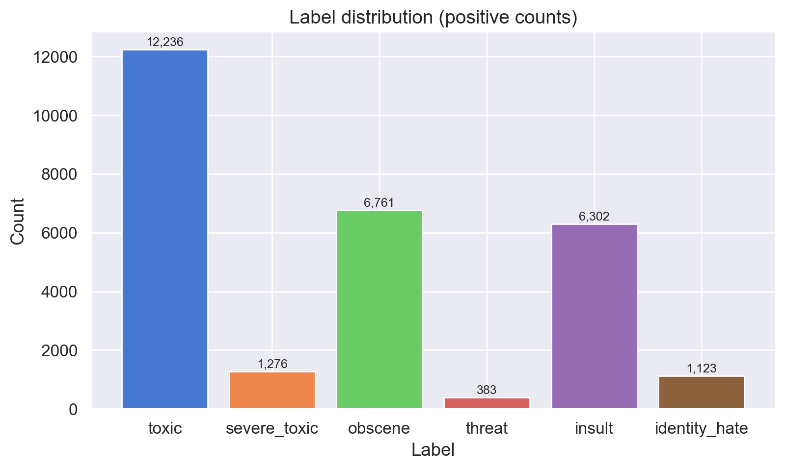

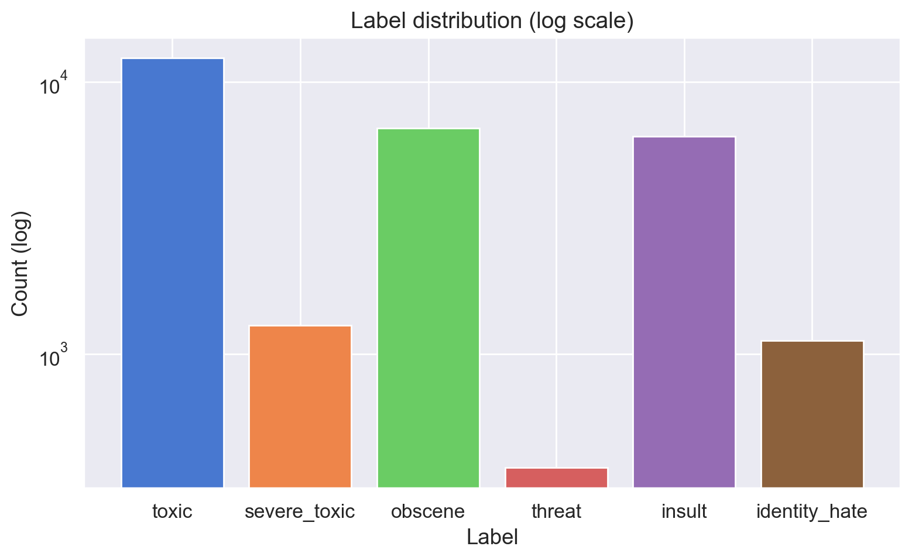

## 5. (b) Labels Per Comment

- 89.83% of training comments have zero toxic labels.
- Most toxic comments have only one or two positive labels.

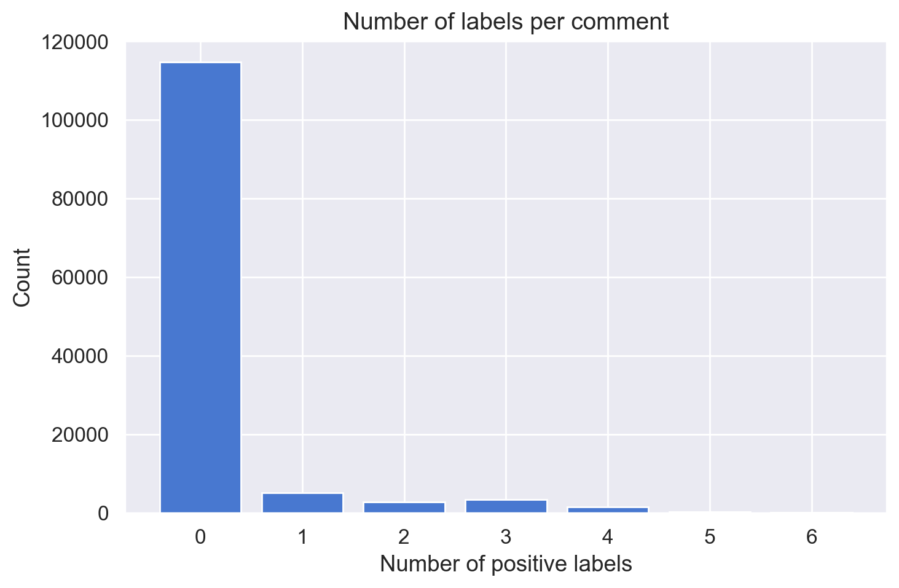

## 6. (c) Label Co-occurrence

The conditional probability matrix P(B|A) reveals that `severe_toxic` is nearly a subset of `toxic`. `obscene` and `insult` are highly correlated.

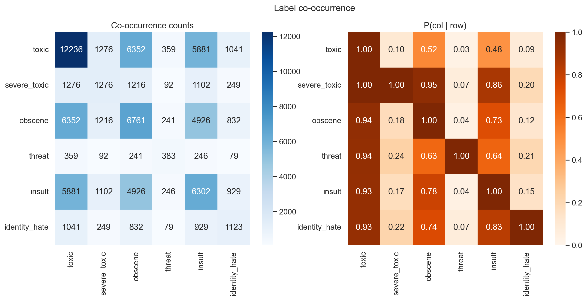

## 7. (d) Text Length

| Stat | n_chars | n_words |
|---|---|---|
| 50th pct | 203.0 | 36.0 |
| 90th pct | 878.0 | 151.0 |
| 99th pct | 3384.85 | 567.0 |

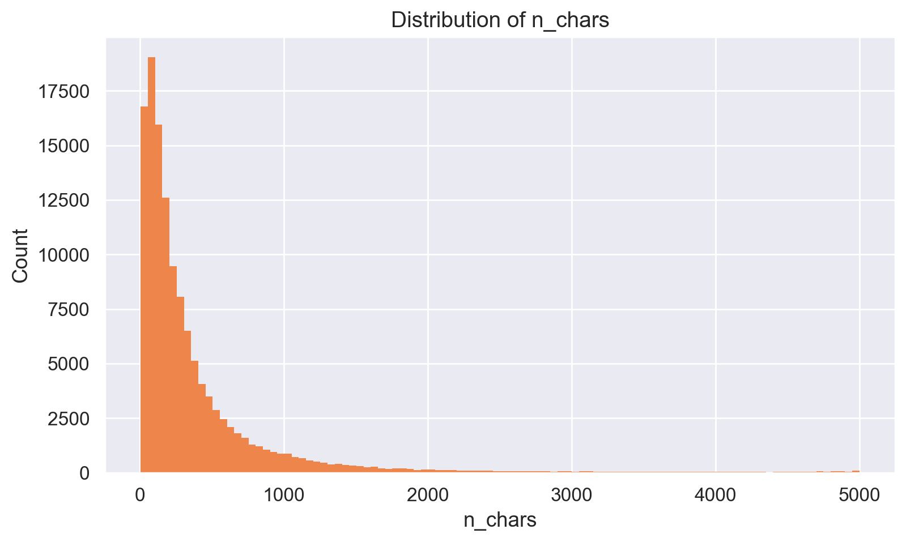

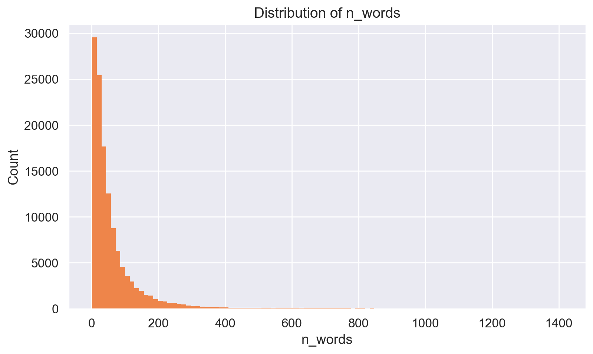

## 8. (e) Tokenized Lengths (roberta-base)

| max_len | Truncation rate (overall) |
|---|---|

| 64 | 40.04% |

| 128 | 18.30% |

| 256 | 6.46% |

| 512 | 2.06% |

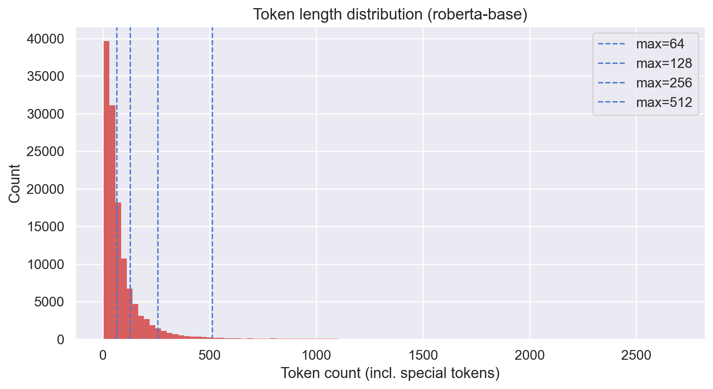

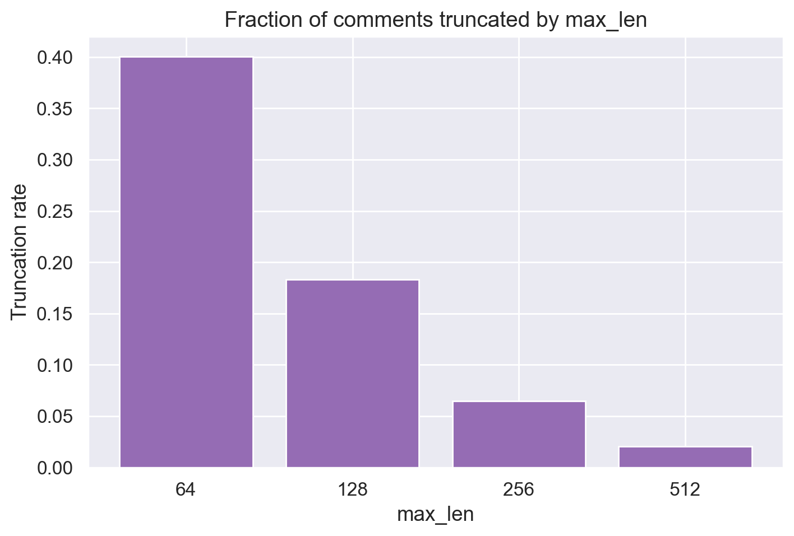

## 9. (f) Style and Obfuscation Features

Style features (uppercase ratio, punctuation ratio, max repeated char run, non-ASCII ratio, obfuscation patterns) are systematically elevated in toxic comments across all labels.

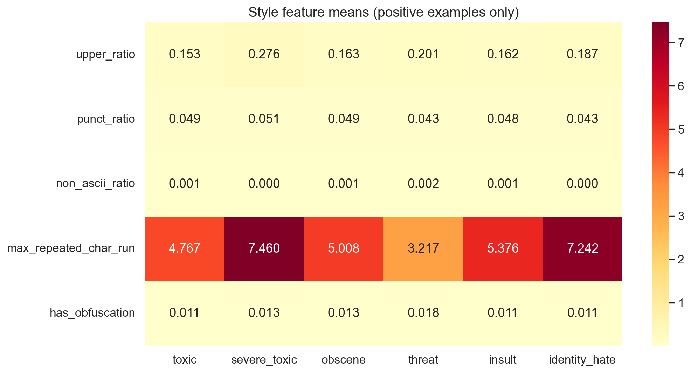

## 10. (g) Lexical Analysis

Log-odds with Dirichlet prior identifies the most label-distinctive terms. Toxic-label comments show strong lexical signals. Rare labels (threat, identity_hate) have fewer high-confidence distinctive terms.

See `reports/eda/tables/g_*_logodds.csv` for full tables and `figures/g_*_logodds.png` for charts.

## 11. (h) Identity Term Analysis

Identity terms flagged as potential spurious correlates (toxic rate ≥ 30%): **gay, jew, lesbian**.

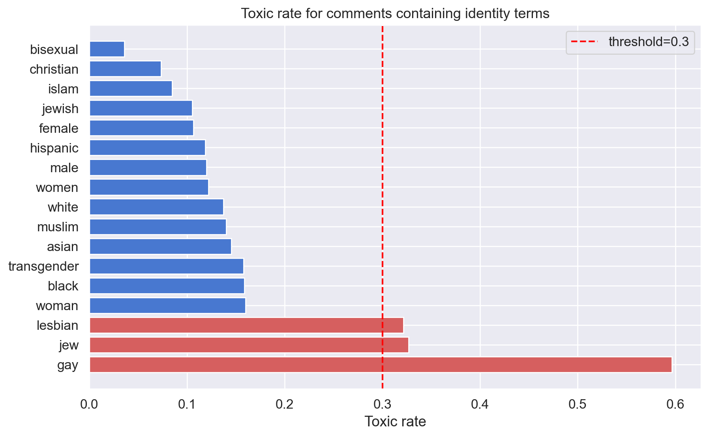

## 12. (i) Label Noise Probes

- Non-toxic comments containing profanity: 430
- Toxic comments with no profanity: 8466
- 30 samples of each saved for manual review.

## 13. (j) Rare-Label Viability

> ⚠️ WARNING: threat has only 47 positives in val split (threshold=100)

> ⚠️ WARNING: threat has only 48 positives in test split (threshold=100)

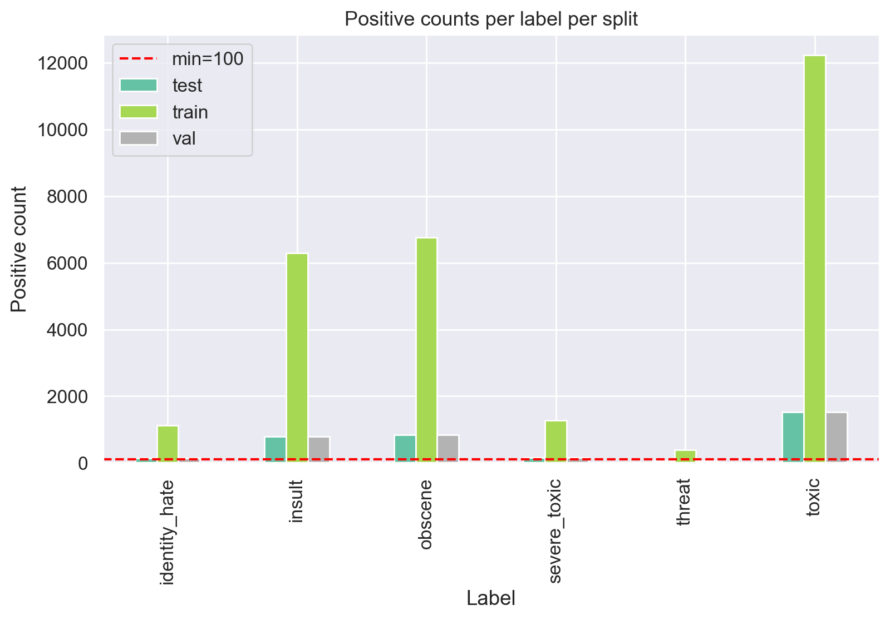

## 14. (k) Split Sanity

Label positive rates are consistent across train/val/test, confirming effective multilabel stratification.

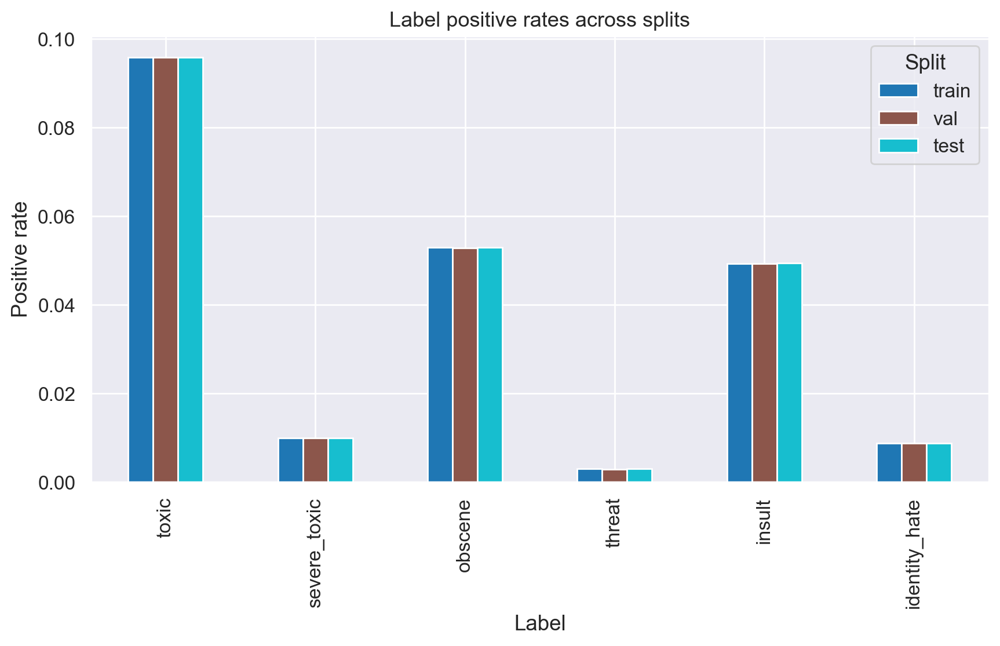

## 15. (l) Vocabulary Stats

| Metric | Value |
|---|---|
| Vocabulary size | 402,135 |
| Hapax count | 261,989 |
| Hapax ratio | 65.15% |
| OOV rate (vs freq≥5 vocab) | 86.12% |

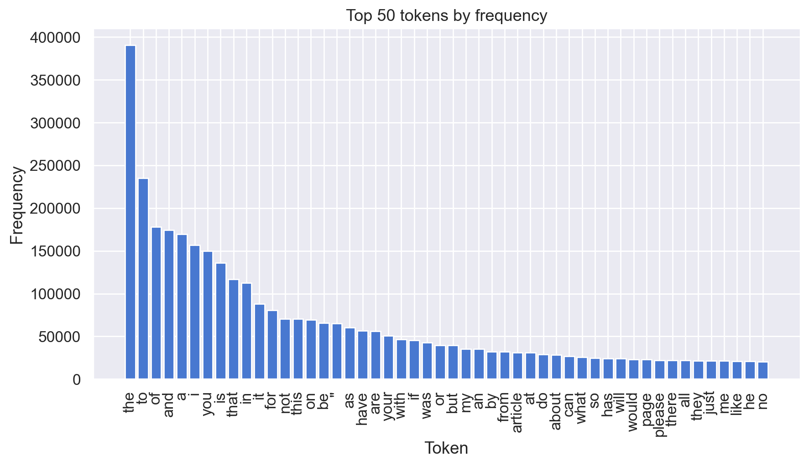

## 16. Conclusions

See `reports/eda/eda_conclusions.md` for the full numbered findings list with modeling implications.

## 17. Reproducibility

- **Seed**: 42 everywhere (Python, NumPy, iterstrat).
- **Config**: All paths and hyperparameters in `configs/config.yaml`.
- **Pinned versions**: `requirements.txt`.
- **Run order**: `make all` (setup → download → preprocess → eda → report → test).
- **Colab**: Set runtime CWD to project root. No absolute paths used.
- **Data source**: `data/raw/raw_manifest.json` records source, date, and SHA-256 hashes.
